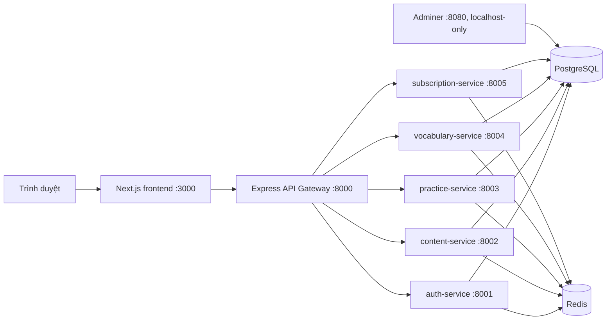

# BÁO CÁO TỔNG QUAN DỰ ÁN PARROTO

> Tài liệu mô tả mã nguồn và cấu hình hiện có trong repository. Các tính năng cần tài khoản/khóa của nhà cung cấp bên ngoài được ghi rõ là phụ thuộc cấu hình. Tài liệu không khẳng định ứng dụng đã được triển khai công khai.

## 1. Thông tin chung

**Parroto** là ứng dụng web hỗ trợ người Việt học tiếng Anh qua bài học, luyện nghe chép chính tả, luyện phát âm theo câu, học từ vựng và ôn tập lặp lại ngắt quãng. Ứng dụng có tài khoản người học, khu vực quản trị, trò chơi từ vựng, điểm kinh nghiệm và các gói đăng ký.

### Mục tiêu

- Cung cấp một nơi để người học tìm bài, nghe audio, luyện nghe và luyện nói.
- Hỗ trợ ghi nhớ từ/câu qua flashcard và lịch ôn tập.
- Theo dõi hoạt động học tập, kết quả và tiến trình.
- Cung cấp chức năng quản lý nội dung, bộ từ vựng và gói dịch vụ.
- Có thể chạy toàn bộ hệ thống cục bộ bằng Docker Compose để phát triển và trình diễn.

### Đối tượng sử dụng

- **Khách:** xem nội dung công khai và tra từ điển.
- **Người học:** luyện tập, lưu từ, ôn tập, chơi trò chơi và quản lý tài khoản.
- **Quản trị viên:** quản lý bài học, từ vựng, giao dịch, gói dịch vụ và mã kích hoạt theo quyền cấu hình.

## 2. Phạm vi và chức năng

### 2.1. Tài khoản và hồ sơ

- Đăng ký, đăng nhập bằng email và mật khẩu.
- Phát hành access token/refresh token dạng JWT.
- Đăng xuất, xem và cập nhật hồ sơ, đổi mật khẩu, xóa tài khoản.
- Có luồng đăng nhập Google/Apple ở backend; khả năng sử dụng phụ thuộc cấu hình OAuth và giao diện hiện hành.
- Trạng thái đăng nhập phía trình duyệt được lưu trong Zustand/localStorage; frontend gửi JWT trong các request cần xác thực.

### 2.2. Bài học và nội dung

- Danh sách bài học, lọc theo trình độ CEFR, tìm kiếm và xem chi tiết bài.
- Bài học chứa các câu, transcript, IPA, bản dịch tiếng Việt và audio.
- Audio toàn bài hoặc theo câu được phục vụ qua content-service.
- Quản trị viên có thể quản lý bài, câu và audio qua khu vực admin.
- Repository có dữ liệu bài học mẫu và audio mẫu phục vụ trình diễn.

### 2.3. Luyện tập

- **Dictation:** nghe câu, nhập nội dung, xem phần so sánh từ và kết quả.
- **Shadowing:** ghi âm trong trình duyệt, gửi bản ghi để lưu và chấm phát âm.
- **Lịch sử và thống kê:** ghi lại lượt luyện tập, điểm, thời lượng và tiến trình.
- **Ôn câu:** lưu trạng thái ôn tập câu sai/đến hạn theo chức năng practice.
- Có cấu hình chấm giọng nói mô phỏng cho môi trường demo; Azure Speech là tùy chọn khi cung cấp khóa hợp lệ.

### 2.4. Từ vựng và từ điển

- Duyệt các bộ từ công khai và bộ từ dành cho gói Pro.
- Tạo bộ từ cá nhân, nhóm từ, thêm/sửa/xóa thẻ và nhập dữ liệu từ tệp theo luồng preview/commit.
- Có sổ tay từ vựng và phiên học/ôn theo lịch kiểu Anki.
- Tra cứu từ điển trong thanh tìm kiếm dùng chung trên các khu vực giao diện.
- Gợi ý từ hiển thị nghĩa tiếng Việt và từ loại từ các thẻ công khai miễn phí và thẻ riêng của tài khoản hiện tại.
- Có gợi ý sửa chính tả dựa trên các từ sẵn có trong bộ thẻ.
- Khi không có nghĩa tiếng Việt trong thẻ, backend có thể gọi dịch vụ MyMemory; kết quả được cache và đánh dấu là bản dịch tự động.
- Có thể tra cụm từ. Lịch sử tối đa 8 mục gần nhất được lưu ở localStorage trên trình duyệt hiện tại.
- Định nghĩa tiếng Anh, IPA và audio có thể lấy từ Free Dictionary API; dịch vụ ngoài có thể không phản hồi hoặc không có dữ liệu.

### 2.5. Trò chơi và động lực học tập

- Có các trò chơi/phiên luyện từ vựng, lưu kết quả và tiến trình.
- Hệ thống gamification có XP, cấp độ, kim cương, điểm danh, nhiệm vụ ngày và bảng xếp hạng XP tuần.
- Một số sự kiện XP được chuyển giữa practice-service và vocabulary-service qua endpoint nội bộ.

### 2.6. Gói dịch vụ và quản trị

- Danh sách gói, trạng thái đăng ký, lịch sử giao dịch và kích hoạt bằng mã.
- Có tích hợp thanh toán VNPay và SePay; giao dịch thật cần thông tin merchant/secret tương ứng. Môi trường demo có thể dùng chế độ sandbox.
- Khu vực admin gồm các trang quản lý bài học, bộ từ, nhập từ, mã kích hoạt, gói, giao dịch và người dùng.
- Quyền admin hiện được xác định bằng danh sách email `ADMIN_EMAILS`, chưa phải hệ thống phân quyền vai trò tổng quát.

## 3. Kiến trúc hệ thống

Ứng dụng áp dụng kiến trúc microservice. Frontend chỉ gọi API Gateway; Gateway chuyển tiếp request đến service phụ trách nghiệp vụ.



PostgreSQL chạy một server nhưng mỗi service dùng database và role riêng. Redis là một server dùng chung cho cache và blacklist token; các key được phân vùng theo mục đích/service. Các service giao tiếp trực tiếp với nhau cho một số nghiệp vụ nội bộ, ví dụ kiểm tra Premium và gửi sự kiện XP.

### 3.1. Các thành phần backend

| Thành phần | Cổng nội bộ | Trách nhiệm chính | Cơ sở dữ liệu |
|---|---:|---|---|
| `auth-service` | 8001 | Đăng ký/đăng nhập, JWT, hồ sơ, quản trị người dùng | `auth_db` |
| `content-service` | 8002 | Bài học, câu, transcript, audio | `content_db` |
| `practice-service` | 8003 | Dictation, Shadowing, kết quả, thống kê, ôn câu | `practice_db` |
| `vocabulary-service` | 8004 | Bộ từ, thẻ, từ điển, SRS, trò chơi, XP/gamification | `vocabulary_db` |
| `subscription-service` | 8005 | Gói, đăng ký, giao dịch, VNPay/SePay, mã kích hoạt | `subscription_db` |
| `api-gateway` | 8000 | CORS, rate limit, xác thực request và định tuyến API | Không có DB riêng |

### 3.2. Frontend

Frontend dùng Next.js App Router, React, TypeScript và Tailwind CSS. Các trang được chia thành trang công khai, khu vực người học và khu vực quản trị. TanStack Query quản lý dữ liệu từ API; Axios gửi request; Zustand lưu trạng thái xác thực.

Các route tiêu biểu:

| Nhóm | Route tiêu biểu |
|---|---|
| Công khai | `/`, `/lessons`, `/lessons/[id]`, `/pricing`, `/login`, `/register` |
| Học tập | `/dashboard`, `/lessons/[id]/dictation/[sentenceId]`, `/lessons/[id]/shadowing/[sentenceId]`, `/practice/history` |
| Từ vựng | `/vocabulary`, `/vocabulary/decks/[id]`, `/vocabulary/review`, `/vocabulary/notebook`, `/vocabulary/my-decks` |
| Trò chơi/tài khoản | `/games`, `/profile`, `/subscription` |
| Quản trị | `/admin`, `/admin/lessons`, `/admin/vocabulary`, `/admin/plans`, `/admin/transactions`, `/admin/users` |

### 3.3. Định tuyến API

Gateway nhận các tiền tố chính sau và proxy đến service tương ứng:

| Tiền tố | Service |
|---|---|
| `/auth` | auth-service |
| `/content` | content-service |
| `/practice` | practice-service |
| `/vocabs` | vocabulary-service |
| `/subscriptions` | subscription-service |
| `/health` | API Gateway |

Endpoint đọc từ điển công khai có thể nhận JWT tùy chọn để bổ sung thẻ riêng của người dùng. Các request ghi dữ liệu và endpoint riêng tư yêu cầu xác thực.

## 4. Công nghệ sử dụng

| Khu vực | Công nghệ |
|---|---|
| Giao diện | Next.js 14, React 18, TypeScript, Tailwind CSS |
| API Gateway | Node.js 20+, Express, http-proxy-middleware |
| Backend nghiệp vụ | Java 21, Spring Boot 3.2, Spring Web, Spring Data JPA, Spring Security |
| Database | PostgreSQL 16, Flyway migrations |
| Cache/blacklist | Redis 7 |
| Đóng gói | Docker, Docker Compose |
| Kiểm thử/CI | JUnit/Spring test, Vitest, script kiểm tra frontend/gateway/Java, GitHub Actions |
| Tích hợp tùy chọn | Google/Apple OAuth, AWS S3, Azure Speech, VNPay, SePay, MyMemory, Free Dictionary API |

## 5. Mô hình dữ liệu tổng quát

Mỗi backend service sở hữu database riêng. Các bảng/nhóm dữ liệu chính gồm:

| Database | Dữ liệu tiêu biểu |
|---|---|
| `auth_db` | Người dùng, thông tin đăng nhập và hồ sơ |
| `content_db` | Bài học (`lesson`), câu (`sentence`) và metadata/audio |
| `practice_db` | Lượt luyện (`practice_attempt`), mục tiêu ngày (`goal_day`), trạng thái ôn câu (`sentence_review`) |
| `vocabulary_db` | Bộ từ/thẻ (`vocab_deck`, `vocab_card`), sổ tay/SRS, nhóm, phiên trò chơi, XP, kim cương và gamification |
| `subscription_db` | Gói (`plan`), đăng ký (`subscription`), giao dịch (`payment_transaction`), mã kích hoạt (`activation_code`) |

Schema được tạo ban đầu bởi `init-db.sql` và các script `initdb/`. Thay đổi schema mới của Java service được quản lý bằng Flyway tại `services/<service>/src/main/resources/db/migration/`. Không nên sửa trực tiếp migration đã chạy trên môi trường có dữ liệu.

### Tài khoản database mặc định cho môi trường phát triển

| Database | Username | Mật khẩu mặc định |
|---|---|---|
| `auth_db` | `auth_user` | `auth_password` |
| `content_db` | `content_user` | `content_password` |
| `practice_db` | `practice_user` | `practice_password` |
| `vocabulary_db` | `vocabulary_user` | `vocabulary_password` |
| `subscription_db` | `subscription_user` | `subscription_password` |

Giá trị thật có thể được ghi đè bằng `*_DB_PASSWORD` trong `.env`. Mật khẩu role được tạo khi PostgreSQL khởi động lần đầu trên volume rỗng; đổi `.env` sau đó không tự đổi mật khẩu đã tồn tại trong PostgreSQL.

## 6. Bảo mật và phân quyền

- JWT dùng chung secret giữa Gateway và các service để mỗi service tự kiểm tra token.
- Gateway kiểm tra token, áp dụng rate limit và chuyển tiếp request; một số kiểm tra quyền vẫn được lặp ở service nghiệp vụ.
- Request nội bộ dùng `INTERNAL_TOKEN` qua header `X-Internal-Token`.
- PostgreSQL, Redis và các cổng service Java không được publish ra host theo cấu hình mặc định; chỉ frontend và API Gateway được mở ra host.
- Adminer được cấu hình bind vào `127.0.0.1`, không mở giao diện DB ra mạng ngoài.
- Dữ liệu JWT frontend lưu ở localStorage; cần cân nhắc rủi ro XSS khi triển khai thực tế.
- `ADMIN_EMAILS` là cơ chế MVP để giới hạn admin; chưa thay thế được role/permission policy đầy đủ.
- JWT blacklist phụ thuộc Redis; khi Redis không sẵn sàng, một số kiểm tra được thiết kế fail-open để giữ tính sẵn sàng.

## 7. Chạy dự án cục bộ

### 7.1. Yêu cầu

- Docker Engine/Desktop và Docker Compose.
- Git để lấy mã nguồn.
- Các tích hợp OAuth, AWS, Azure hoặc thanh toán có thể để trống khi chạy demo; `JWT_SECRET` và `INTERNAL_TOKEN` phải có giá trị đủ dài theo yêu cầu trong `.env.example`.

### 7.2. Khởi động

Từ thư mục gốc repository:

```bash
cp .env.example .env
# Thay JWT_SECRET và INTERNAL_TOKEN bằng chuỗi ngẫu nhiên riêng trước khi chạy.
docker-compose up -d --build
docker-compose ps
```

Ứng dụng frontend: <http://localhost:3000>  
API Gateway health: <http://localhost:8000/health>

### 7.3. Xem dữ liệu database qua trình duyệt

Adminer đã được thêm vào Compose, chỉ lắng nghe trên máy local:

```bash
docker-compose up -d adminer
```

Mở <http://localhost:8080>, chọn **System: PostgreSQL**, **Server: `postgres`**, rồi nhập database, username và password tương ứng trong bảng trên. Nếu dùng phiên bản Compose mới, có thể dùng `docker compose` thay cho `docker-compose`.

### 7.4. Các thao tác thường dùng

```bash
docker-compose logs -f vocabulary-service
docker-compose up -d --build vocabulary-service
docker-compose restart api-gateway
docker-compose down
```

`docker-compose down -v` xóa volume database/cache và làm mất dữ liệu cục bộ; chỉ dùng khi chủ động muốn tạo lại toàn bộ dữ liệu ban đầu.

## 8. Cấu hình môi trường và tích hợp ngoài

Cấu hình mẫu ở `.env.example`; không commit file `.env` chứa secret.

| Biến/cấu hình | Công dụng |
|---|---|
| `JWT_SECRET`, `INTERNAL_TOKEN` | Bắt buộc cho xác thực JWT và request nội bộ |
| `*_DB_PASSWORD` | Mật khẩu role từng service |
| `GOOGLE_CLIENT_ID`, `GOOGLE_CLIENT_SECRET`, `APPLE_CLIENT_ID` | Đăng nhập OAuth |
| `STORAGE_PROVIDER`, `AWS_*`, `S3_*` | Lưu file audio/ghi âm trên S3 hoặc local |
| `SPEECH_PROVIDER`, `AZURE_SPEECH_*` | Chấm phát âm Azure hoặc mock |
| `PAYMENT_PROVIDER`, `VNPAY_*`, `SEPAY_*` | Tích hợp thanh toán |
| `MAIL_*` | Email thông báo nếu được cấu hình |
| `NEXT_PUBLIC_API_URL`, `FRONTEND_URL` | Địa chỉ frontend/API cho trình duyệt, CORS và callback |

Khi không có thông tin S3/Azure, chế độ `auto` có thể dùng file local và bộ chấm điểm demo theo cấu hình. Dịch vụ từ điển/translation cũng có thể bị giới hạn hoặc tạm thời không hoạt động; ứng dụng vẫn có thể trả dữ liệu đã lưu/cache.

## 9. Triển khai frontend và backend

Repository hiện cung cấp cách chạy Docker Compose trên một máy. Cấu hình mặc định không tự deploy ứng dụng lên Vercel và cũng không công khai backend ra Internet.

Có thể triển khai frontend lên Vercel, nhưng trình duyệt người dùng cần gọi được API Gateway bằng một URL công khai qua `NEXT_PUBLIC_API_URL`; backend trên máy cá nhân mặc định chỉ truy cập được trong mạng máy đó. Để kết nối từ Internet cần hạ tầng mạng phù hợp (ví dụ port forwarding, domain/HTTPS, firewall và cấu hình `FRONTEND_URL`/CORS). Không nên đưa database/PostgreSQL hoặc Adminer ra Internet công khai. Không dùng URL `localhost` làm API URL production vì `localhost` trong trình duyệt của khách là máy của chính khách.

## 10. Kiểm tra và chất lượng

Các script sẵn có:

```bash
scripts/verify-fe.sh
scripts/verify-gw.sh
scripts/verify-java.sh
docker-compose config -q
```

CI trong `.github/workflows/ci.yml` chạy các nhóm kiểm tra frontend, gateway, Java service và cấu hình Compose. Với thay đổi code, có thể build riêng image tương ứng để rút ngắn vòng lặp, nhưng backend Java dùng build context `./services` để Dockerfile truy cập được `services/common`.

## 11. Hạn chế và rủi ro cần lưu ý

1. Môi trường mặc định là demo/phát triển. Cần thay toàn bộ secret mẫu, bật HTTPS và rà soát chính sách CORS trước khi public.
2. Một số tính năng phụ thuộc bên thứ ba, hạn mức miễn phí, khóa API hoặc cấu hình callback.
3. Bản dịch tự động chỉ là tham khảo; chất lượng/khả dụng phụ thuộc nhà cung cấp dịch.
4. Lịch sử tra từ được lưu trong localStorage nên không đồng bộ giữa thiết bị/trình duyệt và sẽ mất khi xóa dữ liệu trình duyệt.
5. Quyền admin hiện dựa trên danh sách email cấu hình; cần hệ thống phân quyền chi tiết nếu mở rộng nhiều vai trò.
6. Cơ sở dữ liệu per-service nằm chung một PostgreSQL instance trong Compose, không phải mỗi service có máy chủ PostgreSQL riêng.
7. Không publish cổng service nội bộ hoặc database trực tiếp khi triển khai production; chỉ mở endpoint cần thiết qua gateway/reverse proxy.

## 12. Cấu trúc repository

```text
api-gateway/       Express gateway và middleware
frontend/          Next.js application
services/common/   Mã Java dùng chung
services/*-service Năm service Spring Boot
initdb/            Tạo role/database và nạp dữ liệu đầu tiên
init-db.sql        Schema/seed ban đầu
scripts/           Script sinh dữ liệu và kiểm tra
docs/              Đặc tả, kiến trúc và báo cáo các giai đoạn
media/             Audio mẫu
docker-compose.yml Cấu hình chạy toàn hệ thống và Adminer
```

## 13. Kết luận

Parroto là nền tảng học tiếng Anh full-stack với frontend Next.js, API Gateway Node/Express và năm backend Spring Boot. Các nghiệp vụ được tách theo domain và database riêng; PostgreSQL và Redis cung cấp lưu trữ/cache dùng chung ở mức hạ tầng. Hệ thống có thể chạy cục bộ bằng Docker Compose, hỗ trợ dữ liệu demo và có đường mở rộng tới các dịch vụ thanh toán, lưu trữ và chấm phát âm. Trước khi đưa vào sử dụng công khai, cần hoàn thiện cấu hình domain/HTTPS, secret, vận hành database/backup, giới hạn truy cập và giám sát các tích hợp ngoài.
