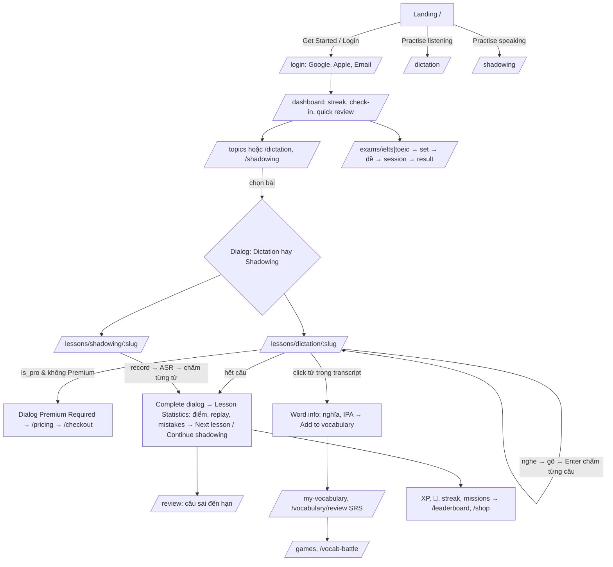

# Phân tích chức năng: parroto.app

> Ngày khảo sát: 2026-10-13. Nguồn: HTML SSR của các trang public, `__NEXT_DATA__` (pageProps + chuỗi i18n), `_buildManifest.js` (toàn bộ route), các JS chunk (`/_next/static/chunks/*`), sitemap, gọi GET các endpoint public **không cần đăng nhập** của `api.parroto.app`, trang App Store.
> Không đăng nhập, không submit form, không dùng trình duyệt.
>
> Quy ước: **[OBS]** = quan sát trực tiếp (HTML/JSON/JS/API response). **[INF]** = suy luận từ tên route, chuỗi i18n, tên endpoint hoặc từ thông lệ.

---

## 0. Kiến trúc kỹ thuật quan sát được

| Hạng mục | Chi tiết | Nguồn |
|---|---|---|
| Frontend | Next.js **Pages Router** (`/_next/static/chunks/pages/...`, `__NEXT_DATA__`), SSR/SSG cho SEO, i18n bằng `next-i18next` (`_nextI18Next.initialI18nStore`) | [OBS] |
| UI | Icon `lucide-react` (vd. `RotateCcw`), component kiểu shadcn/Radix (`Tabs`, `TabsTrigger`…), có Dark/Light mode | [OBS] |
| Backend API | `https://api.parroto.app/api` – REST, JSON dạng `{status, message, data}`. Nhiều endpoint nội dung trả về `{"encrypted":true,"data":"<base64>"}` và payload bài học SSR cũng mã hoá (`pageProps.payload`); client giải mã (có `AES.decrypt`/`subtle.decrypt` trong bundle) | [OBS] |
| Auth | Firebase Auth (project `shadow-dictation`, `authDomain: shadow-dictation.firebaseapp.com`); đăng nhập Google, Apple, Email; API yêu cầu `Bearer token` (vd. `GET /lessons` → `"Bearer token is required"`); `uid` user dạng Firebase UID | [OBS] |
| Realtime | Firebase SDK có Firestore/Realtime DB (`onValue` xuất hiện nhiều) – dùng cho community chat / vocab battle | [INF] |
| Assets | CDN `assets.parroto.app` (thumbnail, audio phát âm `.mp3`, sound effect `correct.mp3`, `complete.mp3`, `notice.mp3`) | [OBS] |
| Video nguồn | YouTube (`type: "youtube"`, URL `youtube.com/watch?v=…`, bundle có `YT.Player` / `iframe_api`) | [OBS] |
| Nhận dạng giọng nói | `transformers.js` (Xenova) được bundle, có model `Xenova/whisper-tiny.en`, `whisper-base.en`; chuỗi UI "Loading voice recognition..." → ASR chạy **trong trình duyệt** cho Shadowing | [OBS] model có trong bundle / [INF] dùng cho shadowing |
| Thanh toán | **Paddle** (price id `pri_…`, `NEXT_PUBLIC_PADDLE_CLIENT_TOKEN`) cho quốc tế; **SePay** (chuyển khoản VietQR, `/webhooks/sepay/generate-code`, `/webhooks/sepay/payment-status`) cho VN; mã kích hoạt; IAP trên app mobile (`price_id: com.oms.parroto.monthly`) | [OBS] |
| Khác | Google Tag Manager, Google AdSense (`adsbygoogle`) → có quảng cáo cho user free; Sentry | [OBS] |
| Mobile | App iOS "Parroto: Shadowing & Dictation" (App Store id6752111996), banner tải app Android/iOS | [OBS] |
| Blog | `/blog/…` (sitemap ~1.560 URL, đa ngôn ngữ) – có vẻ là site riêng (static) | [OBS] |

---

## 1. Tổng quan sản phẩm

- **Định vị** [OBS]: "Learn English online: listening, speaking, vocabulary and exams" – luyện nghe bằng **Dictation** (chép chính tả), luyện nói bằng **Shadowing** trên video thật (YouTube), từ vựng theo ngữ cảnh với **Spaced Repetition**, đề thi thử **IELTS/TOEIC**, game từ vựng, nói chuyện 1-1 với cộng đồng. Trình độ A1→C2.
- **Đối tượng** [OBS/INF]: người tự học tiếng Anh, đặc biệt người Việt (công ty PARROTO CO., LTD.; giá VND riêng; chủ đề "Vietnam today"; cố vấn là giảng viên IELTS/TOEIC VN; shop có background "HUST/NEU chờ tôi nhé"), người luyện thi IELTS/TOEIC/TOEFL.
- **Giá trị chính** [OBS]: học trên nội dung thật (phim, TED, news, bài hát), AI chấm ngay; gamification mạnh (streak, XP/level, kim cương 💎, shop, leaderboard, missions).
- **Ngôn ngữ giao diện** [OBS]: 17 locale qua tiền tố URL: `en` (mặc định, không prefix), `ar, de, el, es, id, ja, ko, ms, pt, ru, th, tr, uk, vi, zh-CN, zh-TW` (vd. `/vi/dictation`). Có `hreflang` đầy đủ. Bản dịch câu/nghĩa từ hiển thị theo "Translation language" (mặc định = ngôn ngữ app).
- **Quy mô** [OBS]: "1,000+ lessons"; Free plan ghi "over 1,000 diverse lessons"; marketing: "500,000+ learners", "50M+ lessons completed", 4.8/5 trên App Store.

---

## 2. Danh sách màn hình / trang

Trạng thái: **G** = guest xem được; **L** = cần đăng nhập để dùng chức năng; **P** = có phần giới hạn Premium.
Toàn bộ route lấy từ `_buildManifest.js` [OBS]. Mọi route đều có biến thể `/{locale}/…`.

### 2.1 Học nội dung (core)

| Route | Mục đích | UI chính | Trạng thái |
|---|---|---|---|
| `/` | Landing | Hero "Get Started Free"; 7 "pillar" (Listening, Speaking & Pronunciation, Speak with Community, Vocabulary, IELTS, TOEIC, Games & Vocab Battle); "How it works" 4 bước; 4 feature block (Dictation, Shadowing, Smart Error Review, Personalized Profile); Why Parroto; Hội đồng cố vấn (3 người); reviews App Store; FAQ; footer [OBS] | G |
| `/dictation` | Danh mục bài luyện nghe (Dictation) | Header giải thích phương pháp; card "Create a lesson from a YouTube video (AI, Pro)"; link "Passive listening", "YouTube channels", "Community lessons"; tab **Beginner / Advanced**; chip tag (`#movie #daily #ielts #toeic #ted #news …` ~26 tag); các section theo topic (tên, "(97 lessons)", "View all") chứa lesson card: thumbnail, lượt xem, CEFR (A1–C2), nguồn `youtube`, thời lượng, tiêu đề, nhãn chế độ, khoá PRO [OBS] | G (xem), L để lưu tiến độ [INF] |
| `/shadowing` | Như `/dictation` nhưng cho Shadowing (cùng layout, nhãn "Shadowing") [OBS] | | G |
| `/topics` | Tất cả topic; card bài có cả 2 nút "Dictation" và "Shadowing"; chọn bài mở dialog "Choose learning mode" (Dictation / Shadowing) [OBS] | | G |
| `/topics/[slug]` | Danh sách bài của 1 topic. 18 topic trong sitemap: ielts-listening, toeic-listening, toefl-listening, movie-short-clip, learning-resources, entertainment, us-uk-song, animals-and-wildlife, science-and-facts, fairy-tale, daily-english-conversation, ipa, news, ted, vietnam-today… [OBS] | Thumbnail, mô tả, tổng số bài, grid bài, phân trang [INF] | G |
| `/lessons/dictation/[lessonSlug]` | **Màn luyện Dictation** | Xem mục 7.1 | G/L, P nếu `is_pro` |
| `/lessons/shadowing/[lessonSlug]` | **Màn luyện Shadowing** | Xem mục 7.2 | G/L, P nếu `is_pro` |
| `/shorts` | "Passive listening" (NEW) – nghe thụ động dạng short video [INF từ nav label] | Client-rendered | G |
| `/review` | Ôn lại các câu đã sai/đến hạn (sentences review) + từ vựng đến hạn; popup "Time for Review! You have N sentences…" [OBS i18n] | | L |
| `/community-lessons` | Bài học do user tạo từ YouTube (AI sinh transcript + level) | Danh sách bài: tiêu đề, CEFR, thời lượng, số câu, tác giả (avatar, level, khung avatar), tag [OBS] | G |
| `/community-lessons/channels`, `/channels/[channelId]` | Duyệt theo kênh YouTube (channelId YouTube `UC…`) [OBS] | | G |
| `/community-lessons/tags`, `/tags/[slug]` | Duyệt theo tag (talks, podcast, stories, drama, work, school, science, vlog, family, business, love, health, music, emotions, food, nature, travel, technology, daily-life…; nhóm `format`/chủ đề) [OBS] | | G |
| `/community-lessons/[id]/edit` | Sửa bài cộng đồng (transcript) [INF] | | L/P |

### 2.2 Từ vựng

| Route | Mục đích | UI chính | Trạng thái |
|---|---|---|---|
| `/vocabulary` | Thư viện **deck** (21 deck public: common-1000, conversation, oxford-3000-a1…b2, oxford-5000-b2/c1, TOEIC…); SEO content về SRS, bảng lượng từ theo CEFR [OBS] | Card deck: thumbnail, tên, CEFR, số thẻ, số group, lượt học, khoá PRO | G |
| `/vocabulary/[slug]` | Chi tiết deck + học flashcard | Preview thẻ (word, IPA US/UK + audio, loại từ, nghĩa dịch, giải thích EN/đa ngữ, ví dụ, ảnh); danh sách group ("Learning group 3/35"); flashcard: Show Answer / Don't Know (Tab) / Check Answer (Enter) / nhập từ; nút đánh giá 1–4 (Again/Hard/Good/Easy); "Start Over" group [OBS] | G xem, L học, P deck pro |
| `/vocabulary/review` | Phiên ôn SRS các thẻ đến hạn; giới hạn "Maximum reviews per day" (1–1000) [OBS] | | L |
| `/vocabulary/cards` | Danh sách thẻ đang học [INF] | | L |
| `/vocabulary/published` | Deck do user publish [INF từ `/vocabulary/enc/public/user-published`] | | G |
| `/my-vocabulary`, `/my-vocabulary/[id]` | Sổ từ cá nhân: deck → group → card do user tạo; import thẻ; giới hạn Premium "10 decks, 250 groups, 8000 cards" [OBS] | | L, P limit |
| `/dictionary/[word]` | Tra từ (SEO): phát âm, ví dụ, "Save to notebook" [OBS] | Ô "Search dictionary" ở header toàn site | G |
| `/games` | Hub game từ vựng (11 game) [OBS] | Card game, "Recent activity", "Top players today" | G |
| `/vocabulary/{typing-game, word-rain, spelling-bee, fruit-toss, sky-runner, bridge-builder, word-match, quiz-meteor, word-guess, bubble-pop}` | Game đơn [OBS] | Chọn deck → chơi | G/L |
| `/vocab-battle` | PvP 1v1 realtime: mỗi vòng 1 từ + 4 đáp án, trả lời đúng nhanh hơn thắng; ghép ngẫu nhiên hoặc phòng riêng với bạn [OBS] | | L |

### 2.3 Thi thử

| Route | Mục đích | Trạng thái |
|---|---|---|
| `/exams/ielts`, `/exams/toeic` | Danh sách **bộ đề** (exam set): "Parroto IELTS 2026/2025" (20 đề/bộ), "Parroto TOEIC Vol.1", "TOEIC 2026/2024/2023" (10 đề/bộ) + nội dung SEO (cấu trúc đề, thang điểm) [OBS] | G |
| `/exams/{type}/sets/[setSlug]` | Danh sách đề trong bộ [OBS route] | G |
| `/exams/{type}/[slug]` | Trang giới thiệu 1 đề, bắt đầu làm full test hoặc từng Part; có bình luận [OBS route + `/exams/comments`] | G, P (TOEIC: "Unlock all TOEIC practice tests") |
| `/exams/{type}/session/[sessionId]` | Làm bài có đồng hồ (TOEIC 200 câu/120 phút, 7 Part) [OBS] | L |
| `/exams/{type}/session/[sessionId]/result` | Kết quả, chấm điểm (TOEIC 10–990), giải thích đáp án [OBS] | L |
| `/exams/{type}/history`, `/analytics` | Lịch sử làm bài, phân tích theo Part/kỹ năng [OBS route] | L |

### 2.4 Gamification / tài khoản / cộng đồng

| Route | Mục đích | Trạng thái |
|---|---|---|
| `/login` | "Continue with Google / Apple / Email" [OBS] | G |
| `/auth/action` | Xử lý link Firebase (verify email / reset password, `oobCode`) [OBS] | G |
| `/link` | Liên kết tài khoản / deep link app [INF] | L |
| `/dashboard` | "Welcome back": streak hiện tại, level + XP tới level kế, nút **Check in** (+50 💎), Streak freeze (mua), Quick review (Learn words / Listen-speak), **heatmap 90 ngày** (active days, active time, longest streak), Milestone rewards (by streak / by level), leaderboard tuần/tháng theo XP hoặc thời gian học; banner quảng cáo [OBS] | L |
| `/missions` | **Daily Missions**: 3 nhiệm vụ/ngày, mỗi cái 30 💎 ("Finish all three for 90 💎"), feed "Recent completers"; mission dạng dictation/vocabulary/ghi âm (audio ≤60s, ≤5MB) [OBS] | L |
| `/leaderboard` | BXH tháng, đếm ngược đóng BXH, chuyển tháng; thưởng top 1/2/3: +1000/+800/+600 💎 + 3 badge giới hạn [OBS] | G xem |
| `/shop` ("Redeem gifts") | Đổi 💎 lấy **Avatar Frame**, **Background** (độ hiếm rare/epic, giảm giá theo thời gian), mua Streak freeze (5.000 💎, tối đa 7); tab Shop / Inventory [OBS] | L |
| `/profile`, `/profile/[id]` | Hồ sơ: avatar + frame/background/badge, level, premium, rank kỹ năng (No Rank → Beginner → Elementary → Intermediate → Upper Intermediate → Advanced → Proficient, riêng cho Dictation & Shadowing), lịch sử ranking, username, ngày sinh; kết bạn [OBS i18n + API] | G/L |
| `/my-notes` | Ghi chú theo câu (sentence notes) [OBS] | L |
| `/community`, `/community/[postId]` | Forum: post theo category, "Favorites", "Editor's Choice", bình luận, report, "My Stats" [OBS] | G xem, L đăng |
| `/chat` | Community Chat (phòng chung) + tab Friends + private chat (block, unread) [OBS] | L |
| `/practice-english-speaking` | Landing tính năng **voice chat 1-1/nhóm nhỏ** với người cùng trình độ CEFR, theo topic (Everyday, Travel, Work, IELTS/TOEIC Speaking…), phòng public/private, gợi ý câu hỏi [OBS]. Trang thực hiện cuộc gọi không thấy route riêng trên web → có thể chỉ trên app mobile hoặc nằm trong `/chat` [INF] | G |
| `/feedbacks` | Góp ý công khai của cộng đồng + của tôi [OBS] | G/L |
| `/affiliate` ("Referrals") | Mã giới thiệu, hoa hồng, payout profile, rút tiền [OBS] | L |
| `/pricing`, `/checkout`, `/activation` | Gói giá, thanh toán, nhập mã kích hoạt Premium [OBS] | G/L |
| `/about-us`, `/about-us/advisors`, `/authors`, `/contact-us`, `/privacy-policy`, `/terms-of-service` | Trang tĩnh [OBS] | G |

Layout chung [OBS]: sidebar trái thu gọn được ("Collapse") gồm Home, Topics, Listening, Pronunciation, Vocabulary, Speaking, TOEIC Exams, IELTS Exams, Games, Passive listening (NEW), Review, Community, Leaderboard, Chat, Community feedback, Redeem gifts, Referrals, Pricing; top bar: ô tra từ điển, chọn ngôn ngữ, streak 🔥, ví 💎, thông báo, avatar menu (Profile, My notes, My vocabulary, Dark mode, Logout). Guest: top nav rút gọn (Listening, Pronunciation, Vocabulary, Speaking, IELTS Exams, More) + "Login"/"Get Started".

---

## 3. Luồng điều hướng chính



Luồng con:
1. **Tạo bài từ YouTube** (Pro, giới hạn N bài/tháng): `/dictation` → "Create lesson" → dán link → AI sinh transcript + level → bài xuất hiện ở `/community-lessons` [OBS UI text].
2. **Ôn tập**: popup "Time for Review!" khi có câu/từ đến hạn → `/review` hoặc `/vocabulary/review` [OBS].
3. **Mua Premium**: `/pricing` (chọn 1 tháng/3 tháng/1 năm/Lifetime) → đăng nhập bắt buộc ("You need to log in to continue with payment") → Paddle overlay hoặc SePay QR (VN) → "Thank you" ; hoặc `/activation` nhập code [OBS].

---

## 4. Mô hình dữ liệu suy ra

Backend dùng MongoDB (id dạng ObjectId 24 hex, trường `__v`, `deleted_at`) [OBS dấu hiệu → INF về DB].

```
Topic/Category  [OBS]  _id, name, slug, order, description, type, status(APPROVED), tag, thumbnail,
                       total_lessons, meta.translations{locale:{page_title,page_description}}, created_at, updated_at (unix)
Lesson          [OBS]  _id, title, slug, duration("02:24"), difficulty(A1..C2), thumbnail, type("youtube"),
                       is_pro, total_view_count, localized{locale:{title}}, category/topic ref [INF],
                       youtube video id/url [INF], sentences[] [INF – payload mã hoá]
CommunityLesson [OBS]  _id, title, slug(hex16), difficulty, duration, url(YouTube), thumbnail(i.ytimg),
                       tags[], tag_translations{en,vi}, sentence_count, total_view_count, created_by, created_at, author{UserPublic}
Sentence/Segment [INF] _id, lesson_id, order, start_ms, end_ms, text, ipa, translation{locale}, words[]
                       (dựa trên: report lỗi "English subtitle / IPA / word / not synced", hiển thị IPA, dịch)
UserSentenceProgress [INF] user, sentence, mode(dictation|shadowing), attempts, replays, mistakes, revealed_words,
                       score/accuracy, completed  (→ "Average replays/mistakes/attempts per sentence", "Last/Average attempt accuracy")
LessonProgress  [INF]  user, lesson, mode, completed_sentences, final_score, time_spent, completed_at
SentenceNote    [OBS endpoint] user, sentence, note
SentenceError report [OBS endpoint] sentence, types[sub|ipa|word|synced|other], corrected_sub, corrected_ipa, text
Deck            [OBS]  _id, name, slug, translations, description, difficulty, is_pro, total_cards, total_groups,
                       tags[], study_count, category, cluster("topic"|"level"), thumbnail, order, meta
Card            [OBS]  _id, word, type(noun/verb/...), phonetics[{text, audio, locale en-UK|en-US}],
                       translation{locale}, explanation{locale}, example{locale}, image_url, group_id, deck_id, order
CardGroup       [OBS]  _id, deck_id, order (deck 759 thẻ / 35 group)
UserCardState   [INF]  user, card, SRS state (due, interval, ease/stability, reps, lapses), rating 1..4
UserDeck/Group/Card [OBS endpoints] sổ từ cá nhân (CRUD + import)
User            [OBS]  uid(Firebase), username, displayName, photoURL, level, role,
                       selected_avatar_frame, selected_background, selected_badge,
                       premium{status, is_lifetime, expires_at, activated_at, price_id, total_months}
Streak          [OBS config] current, longest, freeze_count(max 7), calendar(checked-in/frozen), milestones claimed
Level/XP        [OBS config] max_level 200, xp_required theo level, milestones (diamonds, badge, frame, background)
Wallet          [OBS endpoint] diamonds
ShopItem        [OBS]  name, type(avatar_frame|background), price, currency(diamond), imageUrl, properties{rarity},
                       discount{percentage,startDate,endDate,isActive}, locale, isActive, isApproved
RewardItem/Badge [OBS] code (streak_30d, level_15, frame_30d…), type, image_url, config{x,y,scale}
Mission         [OBS config] reward_diamond_per_mission 30, ttl_days 7, loại dictation/vocabulary/audio
Leaderboard     [OBS]  period(weekly|monthly), metric(diamonds_earned | xp | active time), entries[{rank,user_id,total,user,level}]
ExamType/ExamSet/Exam/ExamSession [OBS] ExamSet{exam_type_id{code,name}, name{en,vi}, slug, source, year, total_exams, order, is_active};
                       Session{start, answers, score, result} [INF]
Price           [OBS]  Paddle price: id, name, unit_price{amount,currency}, unit_price_overrides[{country_codes,unit_price}], custom_data{duration(months), is_lifetime}
Promo           [OBS]  code, name, discount_rate, starts_at, ends_at, allowed_priceIds, allowed_providers(sepay|paddle)
Post/Comment, Friend, PrivateChat, Notification, Feedback, Affiliate(referral, commission, payout) [OBS endpoints]
LearningTime    [OBS endpoints] start / heartbeat / end → tính "Active time"
```

---

## 5. API / endpoint quan sát được

Base: `https://api.parroto.app/api` [OBS]. Danh sách lấy từ các lời gọi `.get/.post/.put/.patch/.delete("…")` trong bundle [OBS]; method/ý nghĩa ghi theo bundle, ý nghĩa chi tiết là [INF]. Endpoint đánh dấu ✅ đã gọi thử public và có dữ liệu.

**Bài học & câu**
- `GET /lessons` (cần Bearer), `GET /lessons/daily` ✅ (bài nổi bật hôm nay), `GET /lessons/suggest`, `GET /lessons/progress`
- `POST /lessons/complete`, `POST /lessons/reset`, `POST /user/lesson-progress`, `GET /user/completed-sentences/{lessonId}`
- `POST /sentences/submit` (dictation), `POST /sentences/submit-shadowing`
- `GET /sentences/review`, `POST /sentences/review/submit`, `POST /sentences/review/submit-shadowing`
- `GET/POST/PUT/DELETE /sentence-notes`, `POST /sentence-errors` (báo lỗi phụ đề/IPA)
- `GET /lessons/{id}/comments`, `/comments/replies/…` [OBS path fragment]

**Từ vựng**
- Deck public: `GET /vocabulary/enc/public`, `/vocabulary/enc/public/{id}`, `/vocabulary/enc/public/by-slug/{slug}`, `/vocabulary/enc/public/user-published` (response mã hoá)
- Học SRS: `GET /learning-vocabulary/enc/new`, `/enc/due`, `/cards`, `/stats`, `/groups-progress/{deckId}`, `/session/current`, `/session/history`; `POST /learning-vocabulary/session/start`, `/submit`, `/cards/remove`, `/cards/reset`; `PUT/DELETE /learning-vocabulary/card/{id}`; `DELETE …/deck/{id}`, `…/group/{id}`
- Sổ từ cá nhân: CRUD `/user/vocabulary/decks`, `/groups`, `/cards`, `POST /user/vocabulary/cards/import`, `GET /user/vocabulary/search`; `GET/POST/DELETE /user/vocabulary-review`
- `POST /vocabulary-errors`; Từ điển: `GET /dictionary/search`, `GET /dictionary/word/{word}`

**Thi**: `GET /exams/published/sets` ✅ (mã hoá), `GET /exams/published/{…}`, `GET /exams/{id}`, `POST /exams/sessions/start`, `GET/PUT/POST /exams/sessions/{id}`, `GET /exams/sessions/history`, `/exams/sessions/analytics`, `/exams/comments…`

**Gamification**: `GET /streak`, `/streak/calendar`, `/streak/config` ✅, `/streak/milestones`; `POST /streak/checkin`, `/streak/freeze/buy`, `/streak/milestones/{id}` (claim) · `GET /level`, `/level/config` ✅, `/level/milestones`; `POST /level/milestones/{id}` · `GET /missions/today`, `/missions/feed`, `/missions/config` ✅; `POST /missions/{id}`, `/missions/dictation/submit`, `/missions/vocabulary/submit` · `GET /leaderboard/home?` ✅, `/leaderboard/monthly?` · `GET /wallet` · `GET /shop/items` ✅, `/shop/items/purchased/by-type`; `POST /shop/items/purchase`; `PATCH /shop/items/purchased/{id}` · `GET /games/feed`, `/games/top-players`; `POST /games/sessions` · `POST /learning-time/start|heartbeat|end`

**User/Social**: `GET /user/info`, `/user/info/{uid}`, `/user/stats`, `/user/ranking-history`, `/user/username/check`; `PUT /user/username`, `/user/birthday`, `/user/selected-item` · Friends: `GET /friends`, `/friends/requests/incoming`, `/friends/search`, `/friends/status/{uid}`; `POST /friends/request|accept/{id}|reject/{id}`; `DELETE /friends/{id}` · Private chat: `/private-chat/conversations`, `/private-chat/messages`, `/private-chat/unread-count`, `/private-chat/block…` · `POST /community-chat`, `/community-chat/ban|unban/{uid}`, `PATCH /community-chat/{id}` · Posts: `/posts`, `/posts/categories`, `/posts/comments`, `/posts/reports` · `GET /community-stats/my-stats` · `GET /notifications`, `/notifications/stats`, `DELETE /notifications/read-all` · `POST /feedback`, `GET /feedback/my`, `/feedback/public`

**Thanh toán**: `GET /prices` ✅, `GET /promo/active` ✅, `POST /promo/validate`, `POST /activation-codes/activate`, `POST /webhooks/sepay/generate-code`, `GET /webhooks/sepay/payment-status?code=` · Affiliate: `GET /affiliate/me|packages|referrals|commissions|payouts|payout-profile`; `POST /affiliate/code`, `/affiliate/payouts`, `/affiliate/prepare-paddle-checkout`; `PUT /affiliate/payout-profile`

Response mẫu `GET /streak/config` [OBS]: `daily_checkin_reward: 50`, `freeze_price_diamond: 5000`, `freeze_max_owned: 7`, milestones 3/7/14/30/60/90/120/180/270/365 ngày (20→3000 💎, tặng freeze, frame/background).

---

## 6. Gói giá / Premium

Nguồn: `GET /api/prices` + i18n trang `/pricing` [OBS]. **Thanh toán 1 lần, không tự gia hạn** ("no recurring subscription").

| Gói | USD | VND (override cho VN) | Ghi chú |
|---|---|---|---|
| Free | 0 | 0 | "Free forever, no credit card" |
| 1 month PRO | $3.49 | 79.000đ | duration 1 |
| 3 months PRO | $6.99 | 169.000đ | duration 3 |
| 1 year PRO | $19.99 | 499.000đ | duration 12, "Best Value" |
| Lifetime PRO | $80.00 | 1.849.000đ | is_lifetime |

Khuyến mãi [OBS]: `/promo/active` đang có sự kiện `WOMEN20` giảm 25% cho gói Lifetime, áp dụng cả SePay và Paddle. Mã kích hoạt (activation code) cộng dồn tháng vào hạn Premium hiện có.

**Free** [OBS]: truy cập không giới hạn 1.000+ bài; dictation không giới hạn; shadowing không giới hạn với chấm phát âm cơ bản; theo dõi tiến độ; có quảng cáo; giới hạn sổ từ ("Limit reached – Upgrade to save more").

**Premium** [OBS]: tất cả của Free + mở mọi bài (`is_pro`), mở toàn bộ đề TOEIC, mở mọi deck từ vựng Pro, giới hạn sổ từ/ghi chú cao hơn (10 decks, 250 groups, 8.000 cards), tạo tối đa N bài từ YouTube/tháng (N là hằng số trong code, không đọc được), hỗ trợ ưu tiên, bỏ quảng cáo.

---

## 7. Tính năng đặc trưng

### 7.1 Màn Dictation (`/lessons/dictation/[slug]`)
Nguồn chủ yếu: namespace i18n `lesson` + `settings` + JS chunk của trang [OBS], bố cục cụ thể [INF].
- Video YouTube nhúng (ẩn/hiện "Hide Media", "Large-sized video"), phát theo **từng câu (segment)**: Play/Pause, Replay, Previous, Next; **Playback rate** chỉnh được; "Auto Stop" cuối câu.
- Ô "Type what you hear", Enter để nộp; kết quả "Correct!" / "Not correct. Please try again."; âm thanh hiệu ứng.
- **Chế độ khó** (Settings): Easy (phần lớn từ điền sẵn), Normal (một số từ điền sẵn), Hard (gõ toàn bộ). Kiểu **fill-in-the-blanks**: Space sang ô từ kế, Backspace về ô trước.
- "Automatically reveal words": tự lộ từ đúng khi gõ; nếu tắt phải bấm **Grade**.
- **Gợi ý**: click ô từ để lộ từ (tính là lỗi, trừ điểm); "Show all words" (trừ điểm theo số từ lộ); "Skip this segment".
- Tab **Transcript**: xem toàn bộ phụ đề, bản dịch (chọn ngôn ngữ dịch), IPA; "Take note" theo câu; "Report error" (chỉ sau khi đã trả lời).
- Click 1 từ → **Word info**: loại từ, phát âm US/UK, nghĩa → "Add to vocabulary"; link tra từ điển ngoài.
- **Watch mode**: chuyển Watch ↔ Learn; xem như video thường với phụ đề tuỳ biến (hiện subtitle/dịch/IPA, cỡ chữ, màu chữ/nền); "You were practicing sentence N – Go back".
- **Phím tắt** (cấu hình được, lấy từ bundle [OBS]):
  - Play/Pause: `Tab`
  - Next: `Ctrl/⌘ + →` hoặc `Shift + →`
  - Previous: `Ctrl/⌘ + ←` hoặc `Shift + ←`
  - Replay: tuỳ chọn `` ` ``, `Ctrl`, `⌘`, `Shift`, `Alt`, `Ctrl+R`, `⌘+R`
  - Record (shadowing): `Shift + \``; Play recorded audio: `Space`; Submit: `Enter`
- **Kết thúc**: dialog "Complete Lesson" → **Lesson Statistics**: Final Score (Excellent/Good/Needs Improvement), Average Replays / Mistakes / Attempts per Sentence, Time spent, Sentences dictated, "You might also like", Reset lesson, Continue shadowing.

### 7.2 Màn Shadowing (`/lessons/shadowing/[slug]`)
- Nghe câu → **Record / Stop Recording** (cần quyền micro, hướng dẫn cấp quyền) → "Processing…" → chấm phát âm. ASR chạy trong trình duyệt (Whisper qua transformers.js, "Loading voice recognition…") [INF mạnh].
- Kết quả từng từ tô màu: **Correct** / **Close — minor slip** / **Try again**, lý do: "Vowel off", "Consonant slip" [OBS].
- Nghe lại bản ghi của mình (Space), card trạng thái câu: Completed / Your attempt / Up next; "Last attempt accuracy", "Average accuracy" mỗi câu.
- Setting: "Show video", giọng phát âm US/UK; nút "AI Voice Analysis" (intonation, fluency) đang "Coming soon".
- Thống kê cuối bài: điểm phát âm trung bình, số câu đã shadow, thời gian.

### 7.3 Từ vựng & SRS
- Flashcard 4 nút: 1 Again (10 phút), 2 Hard (1–4 ngày), 3 Good (1–4 ngày), 4 Easy (1–7 ngày) – kiểu Anki/SM-2 [OBS mô tả; thuật toán cụ thể INF].
- Chế độ gõ từ (nhập từ tiếng Anh từ nghĩa), Tab = flip/skip, Enter = check.
- Giới hạn review/ngày cấu hình 1–1000. Học theo group trong deck.
- 11 game: Vocab Battle (PvP), Word Shooter (typing), Word Rain, Spelling Bee, Fruit Toss, Sky Runner, Bridge Builder (xếp câu), Word Match, Quiz Meteor, Word Guess (Wordle), Bubble Pop; sắp có Memory Match. Game dùng deck người học chọn.

### 7.4 Gamification
- **Streak**: check-in hằng ngày +50 💎; streak freeze 5.000 💎 (tối đa 7); mốc 3→365 ngày thưởng 💎, badge, frame, background.
- **Level/XP**: tối đa level 200; mốc level 5/10/15/25/35/50/75/100/150/200 thưởng 💎 + frame/background.
- **Daily missions**: 3/ngày × 30 💎.
- **Leaderboard**: tuần (diamonds earned), tháng (top 3 +1000/800/600 💎 + badge), theo XP / thời gian học.
- **Shop**: đổi 💎 lấy avatar frame/background (độ hiếm, giảm giá theo đợt). Trang trí hiển thị ở mọi chỗ có avatar.
- **Rank kỹ năng** riêng cho Listening/Shadowing: mở khoá sau 50 câu dictation / 30 câu shadowing; 6 bậc Beginner → Proficient.
- Heatmap hoạt động 90 ngày; đo thời gian học thật qua heartbeat.

### 7.5 Khác
- Đa ngôn ngữ 17 locale; nội dung bài/deck có bản dịch theo locale.
- Tạo bài từ YouTube bằng AI (Pro) + thư viện bài cộng đồng theo kênh/tag.
- Cộng đồng: forum, chat chung, bạn bè, chat riêng, voice chat luyện nói theo trình độ CEFR, góp ý công khai, bình luận dưới bài/đề.
- Affiliate/referral có hoa hồng và rút tiền.
- Dark mode; quảng cáo (AdSense + banner nội bộ) cho user free; banner tải app.
- SEO mạnh: trang landing riêng cho từng tính năng/deck/topic/từ điển, FAQ, nội dung dài.

---

## 8. Giới hạn của phân tích
- Không đăng nhập → không thấy UI thật của dashboard có dữ liệu, màn làm đề, review, chat, voice chat; mô tả các màn này dựa trên chuỗi i18n và tên endpoint.
- Payload bài học (`pageProps.payload`) và nhiều response API được **mã hoá** → cấu trúc Sentence/Lesson chi tiết là suy luận.
- Không chụp màn hình (không dùng trình duyệt); bố cục pixel cần kiểm chứng thêm nếu cần clone giao diện chính xác.
- Giá trị N bài YouTube/tháng cho Premium là hằng số trong code đã minify, không xác định được.
