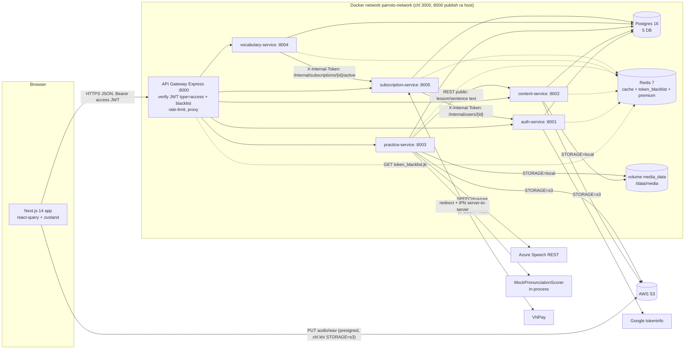

# Kiến trúc & quy ước kỹ thuật: Parroto clone (Phase 1)

> Ngày: 2026-10-13. Nhánh nền: `dev/multi-agent`. Đầu vào: `docs/spec.md` (82 yêu cầu Phase 1), `docs/analysis/current-project.md`, `docs/analysis/parroto-app.md`.
> Tài liệu này là **hợp đồng chung** cho mọi Coder agent: khi `docs/tasks.md` nói "theo hợp đồng", nghĩa là theo mục tương ứng ở đây. Nếu code hiện tại khác tài liệu này, tài liệu thắng; nếu tài liệu sai/thiếu, Coder ghi vào "Review notes" của task chứ không tự đổi hợp đồng.

---

## 1. Stack & phiên bản (cố định)

Phase 1 **giữ nguyên stack**. Không thêm framework, không nâng major version.

| Thành phần | Phiên bản cố định | Ghi chú Phase 1 |
|---|---|---|
| Frontend | Next.js **14.2.35** (App Router, `output: 'standalone'`), React 18.3.1, TypeScript 5.5.3, Tailwind 3.4.6, @tanstack/react-query 5.51.1, axios 1.7.2, zustand 4.5.4, react-hot-toast 2.4.1, clsx 2.1.1, @react-oauth/google 0.12.1 | Chỉ thêm devDependency test: `vitest@1.6.0` (T06). Không thêm thư viện chart/UI. |
| API Gateway | Node **20** (Docker `node:20-alpine`), express 4.19.2, http-proxy-middleware 2.0.6, jsonwebtoken 9.0.2, express-rate-limit 7.4.0, helmet 7.1.0, cors, morgan, uuid | T02: **pin phiên bản chính xác**, thêm `redis@4.6.14` (node-redis) cho blacklist JWT, commit `package-lock.json`, Dockerfile dùng `npm ci`. |
| 5 service Java | Spring Boot **3.2.1**, Java **21**, Spring Web/Data JPA/Redis/Security/Validation/Actuator, PostgreSQL driver 42.7.1, jjwt 0.12.3, Lombok 1.18.48, AWS SDK v2 2.25.3 | Dockerfile: `maven:3.9-eclipse-temurin-21` → `eclipse-temurin:21-jre-alpine` (T01; từ Phase 2 build context là `./services` để build kèm module chung `services/common` = `com.parroto:parroto-common`). `ddl-auto: validate` giữ nguyên; từ Phase 2 schema do **Flyway 9.22.3** (Boot-managed, `db/migration`, V1 = baseline, thay đổi mới từ V2) quản lý — xem README "Operations notes" và `docs/reports/P2-foundation.md`. Test: `spring-boot-starter-test` (JUnit 5 + AssertJ + Mockito) đã có trong pom. |
| Hạ tầng | `postgres:16-alpine` (DB-per-service: auth_db, content_db, practice_db, vocabulary_db, subscription_db), `redis:7-alpine` (cache + blacklist JWT, dùng chung) | Thêm volume `media_data` cho chế độ lưu trữ local (mục 8). |
| Bên thứ ba | AWS S3, Azure Speech (Pronunciation Assessment REST), VNPay, Google Sign-In, SMTP | S3/Azure **tuỳ chọn**: thiếu key → tự chuyển sang mock (mục 8). |

### 1.1 Môi trường kiểm tra tại máy này (đã kiểm tra 2026-10-13)

| Công cụ | Trạng thái | Hệ quả |
|---|---|---|
| `node` | v18.19.1 có sẵn | Đủ chạy script Node đơn giản (`node --check`), **không** dùng để build FE. |
| `npm` / `npx` | **Không có** | Không chạy được `npx tsc` trực tiếp → dùng Docker `node:20-alpine` (dưới đây). |
| `java` | OpenJDK **17** | Không biên dịch được dự án Java 21 trực tiếp → dùng Docker Maven. |
| `mvn` | **Không có** (có sẵn cache `~/.m2/repository`) | Dùng Docker `maven:3.9-eclipse-temurin-21`, mount `~/.m2` để tận dụng cache. |
| `docker` | 29.1.3, daemon chạy được; mạng ra npm/Maven Central/Docker Hub OK | Mọi verify chạy trong container. |
| `docker compose` (plugin) | **Không có**; dùng `docker-compose` (v5.1.1, `/snap/bin/docker-compose`) | Mọi lệnh compose trong tài liệu viết `docker-compose`. |
| Image có sẵn | `postgres:16-alpine`, `redis:7-alpine`, image build cũ `do-an-lien-nganh-*` | Image `node:20-alpine`, `maven:3.9-eclipse-temurin-21` sẽ được pull lần đầu. |

**Lệnh verify chuẩn** (chạy từ thư mục gốc của worktree; T01 sẽ gói thành `scripts/verify-*.sh`, nhưng Wave 1 dùng trực tiếp lệnh dưới):

```bash
# Frontend: type-check + lint + unit test
docker run --rm -u "$(id -u):$(id -g)" -e HOME=/tmp -v "$PWD/frontend":/app -w /app node:20-alpine \
  sh -c "npm ci --no-audit --no-fund && npx tsc --noEmit && npx next lint && npx vitest run"
#   (trước khi T06 merge: chưa có vitest/.eslintrc → chỉ chạy `npm ci && npx tsc --noEmit`)

# Gateway: cài đặt theo lockfile + kiểm cú pháp + nạp module
docker run --rm -u "$(id -u):$(id -g)" -e HOME=/tmp -v "$PWD/api-gateway":/app -w /app node:20-alpine \
  sh -c "npm ci --no-audit --no-fund && node --check server.js && JWT_SECRET=verify_only_secret_at_least_32_characters_long node -e \"require('./middleware/auth')\""

# Một service Java (thay <svc>): compile + unit test
docker run --rm -u "$(id -u):$(id -g)" -e HOME=/tmp -v "$HOME/.m2":/tmp/.m2 \
  -v "$PWD/services/<svc>":/app -w /app maven:3.9-eclipse-temurin-21 \
  mvn -B -q -Dmaven.repo.local=/tmp/.m2/repository test

# Toàn hệ thống (chỉ chạy ở worktree tích hợp, xem mục 10.4)
docker-compose up -d --build && docker-compose ps
```

---

## 2. Sơ đồ hệ thống



---

## 3. Cấu trúc thư mục & chỗ đặt code mới

```
/
├── docker-compose.yml            # T01 (chủ sở hữu duy nhất)
├── docker-compose.override.yml.example   # T01 mới: publish 5432/6379/8001-8005 khi dev
├── .env.example                  # T01
├── init-db.sql                   # T01 (schema giữ nguyên; chỉ seed + bỏ mật khẩu hard-code)
├── initdb/                       # T01 mới: 00-roles.sh (tạo role từ env, psql -v)
├── media/seed/                   # T01 mới: audio mẫu cho seed (mount read-only vào /data/media/seed)
├── scripts/                      # T01 mới: verify-fe.sh, verify-gw.sh, verify-java.sh, gen-seed-audio.sh
├── .github/workflows/ci.yml      # T01 mới
├── api-gateway/                  # T02 (toàn bộ)
│   ├── server.js
│   └── middleware/{auth.js, redis.js (mới), rateLimiter.js, errorHandler.js, logger.js}
├── services/<svc>/src/main/java/com/parroto/<svc>/
│   ├── config/        # SecurityConfig (T02), RequestIdFilter, RedisConfig, S3Config, StorageConfig (mới, T03/T04)
│   ├── controller/    # REST controller, mỏng: validate → service
│   ├── dto/           # Java record, factory from(entity)
│   ├── entity/        # JPA entity — KHÔNG thêm/sửa cột ở Phase 1
│   ├── exception/     # ApiException + GlobalExceptionHandler
│   ├── repository/    # Spring Data JPA; query mới dùng @Query JPQL/native
│   ├── security/      # JwtValidator, JwtAuthFilter, AdminGuard, InternalTokenFilter (T02)
│   ├── service/       # nghiệp vụ; service/storage/, service/speech/ (mới, T03/T04)
│   └── util/          # mới khi cần (AppTime.ZONE …)
├── services/<svc>/src/test/java/com/parroto/<svc>/...   # mới: unit test JUnit 5
└── frontend/src/
    ├── app/                      # route (page.tsx default export)
    │   ├── not-found.tsx, error.tsx, (app)/error.tsx     # T06 mới
    │   ├── (app)/lessons/[id]/result/page.tsx            # T08 mới
    │   ├── (app)/admin/layout.tsx                        # T12 mới (guard isAdmin)
    │   ├── (app)/admin/vocabulary/[deckId]/page.tsx      # T12 mới
    │   └── (app)/admin/activation-codes/page.tsx         # T12 mới
    ├── components/
    │   ├── ui/          # T06: Button, Input, Card, Badge, Modal, Spinner, ErrorState (mới), Pagination (mới), Tooltip/Kbd (mới)
    │   ├── layout/      # T07: AppShell, Sidebar, Topbar, MobileTabBar (mới), MoreDrawer (mới), PublicHeader, AuthGuard (T06)
    │   ├── audio/       # AudioPlayer (T08), Recorder (T09), RecordingPlayer (mới, T06)
    │   ├── practice/    # SentencePlayer, PracticeHeader, ShortcutHelp (mới, T06); WordDiffView + dictation/* (T08);
    │   │                # PhonemeScoreView + shadowing/* (T09); Flashcard + vocab/* (T10)
    │   ├── dashboard/   # T11 mới: WeeklyAccuracyChart, ActivityHeatmap, TrendingErrors
    │   └── admin/       # T12 mới
    ├── hooks/           # T06 mới: useDebounce, useLocalStorage, useHotkeys, useSentenceAudio
    ├── lib/
    │   ├── api.ts, types.ts, endpoints/*.ts, queryKeys.ts (mới), constants.ts (mới), storageKeys.ts (mới),
    │   │   practice-session.ts (mới), practice-nav.ts (mới)          # T06
    │   ├── dictation.ts (mới, T08), srs.ts (mới, T10), audio/wav.ts + audio/recorder-worklet (mới, T09)
    │   └── *.test.ts      # unit test vitest đặt cạnh file
    └── store/auth-store.ts  # T06
```

Quy tắc đặt code mới: **một chức năng → một thư mục chủ sở hữu** như trên. Component dùng cho đúng một màn hình đặt trong `components/<module>/`; chỉ khi dùng ≥ 2 module mới đưa vào `components/ui` hoặc `components/practice` (do T06 sở hữu).

---

## 4. Mô hình dữ liệu (chỉ phần liên quan Phase 1)

### 4.1 Schema: **không đổi**
Không thêm/xoá/sửa bảng hoặc cột (không có migration tool, `ddl-auto: validate`). Mọi tính năng mới dùng cột sẵn có. Flyway là việc đầu tiên của Phase 2.

### 4.2 Ý nghĩa cột được làm rõ (không đổi kiểu)

| Bảng.cột | Quy ước Phase 1 |
|---|---|
| `practice_attempt.audio_recording_url` | Lưu **storage key** (vd `shadowing/<userId>/<recordingId>.wav`), không phải URL. Cùng key cho cả S3 và local. |
| `practice_attempt.score` | Luôn 0–100: `score = accuracy × weight(difficulty)`, weight Easy 0.6 / Normal 0.8 / Hard 1.0 (shadowing: `score = accuracy`). Dữ liệu cũ > 100: README hướng dẫn `UPDATE practice_attempt SET score = LEAST(score, 100);` (thủ công, không tự chạy). |
| `practice_attempt.duration` | Giây (integer). Dùng để tính `minutes` trong activity/heatmap. |
| `lesson.audio_url`, `sentence.audio_url` | Một trong 3 dạng: (a) `https://<bucket>.s3.<region>.amazonaws.com/<key>` hoặc key S3 trần → đọc từ S3; (b) `local:<path>` → đọc file `${MEDIA_ROOT}/<path>`; (c) `NULL` (chỉ sentence) → FE phát đoạn `start_ms–end_ms` của audio bài. |
| `user_vocab.quality` | quality SM-2 cuối cùng (1/3/4/5 từ 4 nút; BE vẫn chấp nhận 0–5). |
| `user_vocab.interval_days` | Số ngày (≥ 1); `next_review_at = now + interval_days` ngày. |
| `vocab_deck.created_by` | userId admin tạo deck (ADM-07). |
| `activation_code.expires_at` | NOT NULL → nếu admin không nhập thì mặc định `now + 365 ngày`. Định dạng code `PROMO-XXXXX-XXXXX` (A–Z, 2–9, bỏ ký tự dễ nhầm 0/O/1/I). |

### 4.3 Seed (T01, `init-db.sql`)
- `plan`: `plan-1month` 79.000đ/30 ngày, `plan-3month` 169.000đ/90 ngày, `plan-1year` 499.000đ/365 ngày. **Bỏ** `plan-lifetime` (Phase 2). `features` giữ dạng JSON array tiếng Việt.
- `activation_code`: 3 mã demo dùng được ngay (`PROMO-DEMO1-MONTH`, `PROMO-DEMO3-MONTH`, `PROMO-DEMOY-EARLY` gắn 3 gói, hết hạn 2027-12-31).
- `lesson.audio_url` / `sentence.audio_url`: trỏ `local:seed/lesson-<n>/full.mp3` và `local:seed/lesson-<n>/s<order>.mp3` (file sinh bằng `scripts/gen-seed-audio.sh`, commit vào `media/seed/`).
- `practice_attempt`: **không** seed (AC streak tự tạo qua API hoặc SQL thủ công trong README).

### 4.4 Redis keys (dùng chung — không đổi format)

| Key | Ghi bởi | Đọc bởi | TTL |
|---|---|---|---|
| `token_blacklist:{jti}` | auth-service (logout) | GW, cả 5 service | thời gian sống còn lại của token |
| `premium:{userId}` | vocabulary + practice `PremiumClient` (cache, cùng format JSON boolean) | vocabulary, practice (P2-A1: bài Pro) | 5 phút; **subscription-service DEL khi kích hoạt premium** (SUB-04) |
| `lessons:list:*`, `lesson:{id}` | content-service | content-service | 24h; xoá khi sửa bài/câu (LES-07) |
| `practice:stats:{userId}*` | practice-service | practice-service | như hiện tại |

Xoá theo pattern dùng `SCAN` (cursor, count 500) + `DEL` theo lô, không dùng `KEYS` (X-06).

### 4.5 Thay đổi DTO / endpoint (hợp đồng API Phase 1)

Path ghi theo gateway. "+" = thêm field (không xoá field cũ, trừ khi ghi rõ).

| Endpoint | Thay đổi | Task BE |
|---|---|---|
| `POST /practice/dictation/attempt` | Body giữ nguyên `{lessonId, sentenceId, userInput, difficulty}` (lưu ý: field là **`userInput`**, spec gọi là `typedText`). `score` ≤ 100. | T03 |
| `GET /practice/attempts`, `/practice/attempts/{id}` | `AttemptSummary` + `difficulty: 'Easy'\|'Normal'\|'Hard'\|null` (`createdAt` đã có ở BE, FE type bổ sung). | T03 |
| `GET /practice/stats/activity?days=90` **NEW** | `ActivityDay[]` = `[{date:'YYYY-MM-DD', attempts:number, minutes:number}]`, đúng `days` phần tử (cũ → mới), ngày trống = 0, timezone `Asia/Ho_Chi_Minh`; `days` 1–365, mặc định 90, ngoài khoảng → 400. | T03 |
| `GET /practice/streak` | Không đổi shape; tính theo `Asia/Ho_Chi_Minh`. | T03 |
| `POST /practice/shadowing/request-upload-url` | Response + `uploadMethod:'PUT'`, `uploadRequiresAuth:boolean`, `contentType:'audio/wav'`, `storage:'s3'\|'local'`. Khi `local`: `uploadUrl` là **path tương đối gateway** `/practice/shadowing/recordings/{recordingId}`. | T03 |
| `PUT /practice/shadowing/recordings/{recordingId}` **NEW (chỉ local mode)** | Bearer bắt buộc; body raw `audio/wav`, ≤ 2 MB, phải có header `RIFF…WAVE`; lưu vào key của chính user → 204. Ở s3 mode → 404. | T03 |
| `POST /practice/shadowing/attempt` | Response + `scorer:'azure'\|'mock'`. Định dạng audio sai → 400 "Định dạng ghi âm không hợp lệ (cần WAV PCM 16 kHz mono)". | T03 |
| `GET /practice/shadowing/{attemptId}/recording` | Chỉ chủ sở hữu; khác user → 404 (SHA-04). | T03 |
| `PUT /content/lessons/{id}/sentences/{sentenceId}` **NEW** | Body `SentenceInput` (mọi field optional: `text, ipa, translationVi, startMs, endMs, sentenceOrder, audioUrl`) → `SentenceResponse`. Admin. Xoá cache. | T04 |
| `DELETE /content/lessons/{id}/sentences/{sentenceId}` **NEW** | → `{message}`; đánh lại `sentence_order` 1..N liên tục. Admin. Xoá cache. | T04 |
| `POST /content/lessons/{id}/upload-audio` | ≤ 50 MB; content-type phải `audio/*` (và đuôi mp3/m4a/wav/ogg/webm) → nếu không 400. | T04 |
| `GET /vocabs/decks/{id}/cards` | `CardResponse` + `userVocabId: string\|null` (khi request có Bearer hợp lệ và user đã học thẻ; ẩn danh → null). | T05 |
| `GET /vocabs/user/review-queue` | `ReviewQueueItem` + `exampleVi, partOfSpeech, audioUrl, imageUrl`. | T05 |
| `POST /vocabs/user/review` | Body không đổi `{userVocabId, quality 0–5}`; lịch theo SM-2 chuẩn (mục 4.6). | T05 |
| `POST /vocabs/user/add-from-lesson` | Thẻ thuộc deck `isProOnly` + user không premium → 403. | T05 |
| `DELETE /vocabs/cards/{id}` **NEW** | Admin → `{message}`; `card_count - 1`; `user_vocab` xoá theo CASCADE. | T05 |
| `GET /subscriptions/vnpay-ipn` **NEW** (public) | Trả `{RspCode, Message}` chuẩn VNPay: `00` OK, `01` không tìm thấy đơn, `02` đã xử lý, `04` sai số tiền, `97` sai chữ ký, `99` lỗi khác. | T05 (+ route GW T02) |
| `POST /subscriptions/admin/activation-codes` **NEW** | Admin; body `{planId, quantity 1–500, expiresAt?: ISO}` → `{codes: ActivationCode[]}`. | T05 |
| `GET /subscriptions/admin/activation-codes?used&page&limit` **NEW** | Admin → `PageResponse<ActivationCode>`; `ActivationCode = {id, code, planId, planName, usedByUserId, usedByEmail\|null, usedAt, expiresAt, createdAt}`. | T05 |
| `POST /subscriptions/activate-code` | Cộng dồn hạn; lỗi: hết hạn → 400 "Mã đã hết hạn", đã dùng → 400 "Mã đã được sử dụng", không tồn tại → 404 "Mã không hợp lệ". | T05 |
| `GET /subscriptions/user` | Bỏ `autoRenew` ở FE type (BE có thể giữ field, FE không đọc). | T12 (FE), T06 (type) |
| `POST /auth/login-google` | `GOOGLE_CLIENT_ID` rỗng → 503 "Google login chưa cấu hình". Tương tự Apple. | T02 |
| `PUT /auth/change-password` | `authProvider != 'local'` → 400. | T02 |

### 4.6 Thuật toán SM-2 (quyết định của người dùng, sửa B11)

4 nút → quality: **Again = 1, Hard = 3, Good = 4, Easy = 5** (phím 1–4). Áp dụng SM-2 chuẩn (Wikipedia/SuperMemo):

```
input: n = repetitions, I = interval_days, EF = ease_factor, q
if q >= 3:
    if n == 0: I' = 1
    elif n == 1: I' = 6
    else: I' = round(I × EF)          # EF trước khi cập nhật
    n' = n + 1
else:                                  # Again
    n' = 0
    I' = 1
EF' = max(1.3, EF + (0.1 − (5−q) × (0.08 + (5−q) × 0.02)))   # làm tròn 2 chữ số (HALF_UP)
next_review_at = now + I' ngày
```

Ví dụ kiểm thử (thẻ n=3, I=10, EF=2.5): Again → n=0, I=1, EF=1.96; Hard → I=25, EF=2.36; Good → I=25, EF=2.50; Easy → I=25, EF=2.60. Ở SM-2 chuẩn, Hard/Good/Easy chỉ khác nhau qua EF (ảnh hưởng lần ôn sau) — đây là hệ quả chấp nhận được của quyết định. FE `lib/srs.ts` cài **cùng công thức** để hiển thị nhãn "1 ngày / 25 ngày" trên nút.

### 4.7 Chấm điểm Dictation (quyết định của người dùng, sửa B10)

`accuracy` = % từ đúng (0–100, giữ thuật toán so khớp + Levenshtein hiện tại). `score = round2(accuracy × w)` với `w = {Easy: 0.6, Normal: 0.8, Hard: 1.0}`, null/khác → Normal. Kẹp `[0, 100]`.

---

## 5. Quy ước API

### 5.1 Body lỗi (mọi service + gateway, giữ nguyên)
```json
{ "error": "Thông điệp đọc được", "status": 404, "timestamp": "2026-10-13T08:00:00Z", "requestId": "uuid" }
```
| Status | Khi nào |
|---|---|
| 400 | Vi phạm nghiệp vụ (mã đã dùng, file không phải audio, `days > 365`, WAV sai định dạng) |
| 401 | Thiếu/sai/hết hạn token, token loại `refresh` dùng sai chỗ, `jti` bị blacklist, thiếu/sai `X-Internal-Token` |
| 403 | Không phải admin, deck Pro khi không premium |
| 404 | Không tìm thấy hoặc **không thuộc sở hữu** (tránh lộ tồn tại, vd recording của user khác) |
| 409 | Xung đột (trùng email…) |
| 422 | Lỗi Bean Validation (`MethodArgumentNotValidException`) — giữ hành vi hiện tại |
| 502 / 503 | Upstream lỗi / tính năng chưa cấu hình (VNPay, Google, Azure khi bắt buộc) |

Thông điệp `error` hiển thị cho người dùng → **tiếng Việt** cho lỗi nghiệp vụ mới; message cũ tiếng Anh giữ nguyên (FE có fallback).

### 5.2 Header & token
- `Authorization: Bearer <access JWT>` cho mọi endpoint cần đăng nhập. `X-Request-Id` do GW sinh, chuyển tiếp xuống service.
- JWT HS256, secret `JWT_SECRET` (≥ 32 byte, **bắt buộc**, không fallback; thiếu → GW `process.exit(1)`, service Java ném `IllegalStateException` khi khởi tạo `JwtValidator`/`JwtService`).
- Claim: `sub` (userId), `email`, `cefrLevel`, `type` (`access` | `refresh`), `jti`, `iat`, `exp`. TTL từ env `JWT_EXPIRY_SECONDS` (3600) / `JWT_REFRESH_EXPIRY_SECONDS` (604800).
- **Chỉ `type=access`** được chấp nhận ở GW và mọi `JwtAuthFilter`. `refresh` chỉ dùng ở body `POST /auth/refresh-token {refreshToken}` → trả `AuthResponse` mới.
- Blacklist: sau verify chữ ký, kiểm tra `EXISTS token_blacklist:{jti}` → 401 "Token đã bị thu hồi". Redis lỗi → **fail-open** + log `WARN` (đánh đổi có chủ đích cho demo; ghi trong README).
- Route public ở GW: `/auth/{register,login,login-google,login-apple,refresh-token}`, `GET /content/**`, `GET /vocabs/decks/**` (Bearer nếu có vẫn được chuyển tiếp), `/subscriptions/plans`, `/subscriptions/payment-callback`, `/subscriptions/vnpay-ipn`.

### 5.3 Xác thực nội bộ service-to-service
- Env `INTERNAL_TOKEN` (chuỗi ngẫu nhiên ≥ 32 ký tự, bắt buộc ở auth, subscription, vocabulary; thiếu → fail khi khởi động).
- Bên gọi gửi header `X-Internal-Token: <INTERNAL_TOKEN>` (vocabulary `PremiumClient` → subscription; subscription `AuthServiceClient` → auth).
- Bên nhận: `security/InternalTokenFilter` (OncePerRequestFilter, chỉ match `/internal/**`, so sánh `MessageDigest.isEqual`) → sai/thiếu: 401 JSON chuẩn. `/internal/**` không bao giờ được route qua GW (GW trả 404).
- Cấu hình: `internal.token: ${INTERNAL_TOKEN:}` trong `application.yml` (T02 thêm block cho cả 5 service).

### 5.4 Phân trang & định dạng
`?page` bắt đầu từ 1, `?limit` (mặc định 20, tối đa 100) → `{data: T[], pagination: {page, limit, total, totalPages}}`. Thời gian ISO-8601 có offset. Tiền: VND, `long`.

---

## 6. Quy ước frontend

### 6.1 Lớp API
- `lib/api.ts`: axios instance duy nhất. Interceptor 401 (AUTH-01): nếu request chưa retry và có `refreshToken` → gọi `/auth/refresh-token` **single-flight** (một Promise dùng chung; các request 401 khác chờ promise đó) → cập nhật store → retry 1 lần. Refresh thất bại → `clearAuth()` + `window.location.href = '/login?next=' + encodeURIComponent(path+search)`. Không refresh cho chính `/auth/refresh-token`, `/auth/login*`. Logic single-flight tách thành hàm thuần `createRefreshQueue()` để unit test.
- `lib/endpoints/<module>.ts`: object `authApi | contentApi | practiceApi | vocabularyApi | subscriptionApi`, mỗi hàm trả `r.data`, có kiểu đầy đủ (không `any`).
- `lib/types.ts`: **mirror chính xác** Java DTO record (tên field, nullable `| null`). Mọi thay đổi ở mục 4.5 được T06 đưa vào **trước** (contract-first) để Wave 2 chỉ tiêu thụ.
- Upload shadowing: nếu `uploadRequiresAuth` → `api.put(uploadUrl, blob, {headers: {'Content-Type': 'audio/wav'}})`; ngược lại `uploadToPresignedUrl(uploadUrl, blob, 'audio/wav')` (không gửi Bearer).

### 6.2 react-query
- Key tập trung ở `lib/queryKeys.ts` (T06), **giữ chuỗi kebab-case hiện có** để không vỡ cache chia sẻ:
  `qk.profile = ['profile']`, `qk.vocabStats = ['vocab-stats']`, `qk.practiceStats = ['practice-stats']`, `qk.streak = ['practice-streak']`, `qk.activity(days)`, `qk.trendingErrors`, `qk.userSubscription = ['user-subscription']`, `qk.plans`, `qk.transactions(page)`, `qk.lessons(params)`, `qk.lessonSearch(q)`, `qk.lesson(id) = ['lesson', id]`, `qk.lessonAttempts(id)`, `qk.lessonStats(id)`, `qk.attempts(params)`, `qk.attempt(id)`, `qk.decks(params)`, `qk.deckCards(id, params)`, `qk.reviewQueue = ['review-queue']`, `qk.learnedWords(params)`, `qk.adminLessons(page)`, `qk.adminDecks`, `qk.adminCards(deckId, params)`, `qk.activationCodes(params)`.
- Sau mutation ảnh hưởng số liệu dùng chung, **invalidate** đúng key: chấm thẻ → `vocabStats`, `reviewQueue`; nộp bài → `practiceStats`, `streak`, `lessonAttempts(id)`, `lessonStats(id)`; kích hoạt premium → `userSubscription`, `profile`.
- Mặc định giữ `providers.tsx` (`retry: 1`, `staleTime: 30s`); query trả 404 không retry (`retry: (n, e) => status !== 404 && n < 1`).

### 6.3 Loading / error / empty
Mẫu bắt buộc cho mọi page (sửa B4):
```tsx
if (isLoading) return <FullPageSpinner />;
if (isError) return <ErrorState error={error} onRetry={refetch} />;   // 404 → "Không tìm thấy …"
if (!data) return <ErrorState notFound />;
```
`ErrorState` props: `{ error?: unknown; notFound?: boolean; title?: string; message?: string; onRetry?: () => void; backHref?: string; backLabel?: string }` — tự nhận diện axios 404. Danh sách rỗng hiển thị empty state có CTA. Toast chỉ cho lỗi **mutation** (`toast.error(apiErrorMessage(err, '…'))`).

### 6.4 UI primitives & style
Tailwind utility + `clsx`, palette `brand`/`ink`, `bg-pro-gradient`; không CSS module, không thư viện UI mới. Dùng `Button, Input/Textarea/Select/FieldWrapper, Card, Badge, Modal, Spinner/FullPageSpinner, ErrorState, Pagination, Kbd`. `Modal` phải render `role="dialog" aria-modal="true"` (dùng cho chặn phím tắt). Vùng chạm ≥ 44px trên mobile; không cuộn ngang ở 360px. UI text tiếng Việt; code/comment tiếng Anh. Hằng số dùng chung: `lib/constants.ts` (`CEFR_LEVELS`, `TOPIC_TAGS` = `daily, travel, work, business, health, education, technology, culture, ielts, toeic, ted, news, movie, song` + nhãn VN, `TOPIC_ICONS`).

### 6.5 Phím tắt
- Hook `useHotkeys(bindings, { enabled })` (T06): bỏ qua khi có `[role="dialog"][aria-modal="true"]` trong DOM; bỏ qua phím ký tự thường khi focus đang ở `input/textarea` **trừ** các tổ hợp có modifier hoặc phím được đánh dấu `allowInInput` (Enter, Tab, Ctrl+Space, Ctrl+R, Ctrl+H, Shift+←/→).
- Bảng phím: Dictation theo spec 3.3; Shadowing: `Shift+\`` ghi/dừng, `Space` nghe lại bản ghi, `Shift+←/→` câu trước/kế; Flashcard: `Space`/`Enter` lật, `1–4` chấm (chỉ khi đã lật). Component `ShortcutHelp` (nút "?") liệt kê phím của màn hiện tại.

### 6.6 Lưu trữ phía client (`lib/storageKeys.ts`)
localStorage (SSR-safe qua `useLocalStorage`, bọc try/catch): `parroto:playback-rate`, `parroto:dictation-difficulty`, `parroto:transcript-ipa`, `parroto:transcript-translation`, `parroto:sidebar-collapsed`, `parroto:review-daily-limit`, `parroto:review-popup-date`. sessionStorage: `parroto:session:{lessonId}:{mode}` = `{startedAt, sentences: {[sentenceId]: {submits, replays, hints, ms}}}` (helper `lib/practice-session.ts`).

---

## 7. Quy ước backend

- **Package:** `com.parroto.<svc>.{config, controller, dto, entity, exception, repository, security, service, util}`. Code mới cho storage/speech: `service/storage/` (`RecordingStorage`/`LessonAudioStorage` + impl) và `service/speech/` (`PronunciationScorer` + impl).
- **Controller mỏng:** nhận `@Valid @RequestBody` record, `@AuthenticationPrincipal AuthenticatedUser`, gọi service; admin kiểm tra bằng `adminGuard.requireAdmin(principal)` ở đầu method.
- **DTO:** Java `record` + Lombok `@Builder` khi > 4 field, factory `static X from(Entity)`. Validation bằng `jakarta.validation` (`@NotNull`, `@Size`, `@Min/@Max`, `@Pattern`). Không trả entity ra ngoài.
- **Exception:** chỉ ném `ApiException.badRequest/notFound/forbidden/conflict` hoặc `new ApiException(HttpStatus, msg)`; `GlobalExceptionHandler` chuyển thành body lỗi chuẩn. Không `catch (Exception)` nuốt lỗi.
- **Transaction:** `@Transactional` ở service method ghi nhiều bảng (callback/IPN, kích hoạt mã, xoá thẻ + card_count, xoá câu + đánh lại thứ tự). IPN/callback **idempotent**: khoá bản ghi giao dịch (`@Lock(PESSIMISTIC_WRITE)` hoặc `UPDATE … WHERE status='pending'` kiểm tra số dòng).
- **Cache:** `CacheService` (get/put JSON + `invalidateByPattern` dùng SCAN). Xoá cache **sau commit** khi có thể (`TransactionSynchronization.afterCommit`) hoặc ngay sau `saveAndFlush`.
- **Thời gian:** `OffsetDateTime`; tính theo ngày dùng `ZoneId.of("Asia/Ho_Chi_Minh")` (hằng số `util/AppTime.ZONE` trong practice-service).
- **Cấu hình:** mọi giá trị nhạy cảm/thay đổi theo môi trường đọc qua `@Value("${...}")` từ `application.yml` → env; **không** default bí mật trong yml. Block yml do task nào sở hữu: xem `docs/tasks.md` §"File dùng chung".
- **Log:** `slf4j`, không log token/secret/mật khẩu; log `requestId`.

---

## 8. Chế độ mock / fallback cho S3 & Azure

Mục tiêu: demo chạy trọn luồng Shadowing và audio bài học **không cần key thật**, đồng thời code S3/Azure được sửa đúng (B1/B2) để khi có key vẫn chạy.

### 8.1 Biến môi trường

| Env | Giá trị | Mặc định | Áp dụng |
|---|---|---|---|
| `STORAGE_PROVIDER` | `auto` \| `s3` \| `local` | `auto` | content-service, practice-service |
| `SPEECH_PROVIDER` | `auto` \| `azure` \| `mock` | `auto` | practice-service |
| `MEDIA_ROOT` | đường dẫn | `/data/media` | content-service, practice-service |

`auto` → `s3` khi `AWS_ACCESS_KEY_ID` và `AWS_SECRET_ACCESS_KEY` đều khác rỗng và không bắt đầu bằng `your_`; ngược lại `local`. `auto` → `azure` khi `AZURE_SPEECH_KEY` khác rỗng và không bắt đầu bằng `your_`; ngược lại `mock`. Chọn `s3`/`azure` tường minh mà thiếu key → **fail khi khởi động** với log rõ. Lúc khởi động log 1 dòng `INFO Storage provider: local (MEDIA_ROOT=/data/media) | Speech provider: mock`.

Cấu hình yml (practice & content, block `app:` cuối file):
```yaml
app:
  storage:
    provider: ${STORAGE_PROVIDER:auto}
    local-root: ${MEDIA_ROOT:/data/media}
  speech:              # chỉ practice-service
    provider: ${SPEECH_PROVIDER:auto}
```

### 8.2 practice-service

```
service/storage/RecordingStorage (interface)
  UploadTarget createUpload(UUID userId)        // {uploadUrl, recordingId, key, expiresIn, requiresAuth, storage}
  void putLocal(UUID userId, String recordingId, byte[] wav)   // local: ghi file; s3: throw notFound
  byte[] read(String key)
  void stream(String key, HttpServletResponse res)             // Content-Type audio/wav
  ├─ S3RecordingStorage   (từ ShadowingStorageService hiện tại; presign PUT contentType "audio/wav")
  └─ LocalRecordingStorage (file ${MEDIA_ROOT}/shadowing/<userId>/<recordingId>.wav, chặn path traversal: recordingId phải là UUID)
config/StorageConfig: tạo đúng 1 bean RecordingStorage theo provider; S3Client/S3Presigner chỉ tạo khi provider = s3.

service/speech/PronunciationScorer (interface)
  AssessmentResult assess(byte[] wav, String referenceText)    // {overallAccuracy, wordScores, scorer}
  ├─ AzureSpeechClient (hiện có; Content-Type "audio/wav; codecs=audio/pcm; samplerate=16000"; nhận WAV đúng chuẩn từ FE)
  └─ MockPronunciationScorer
```
- `WavUtils.validate(byte[])` dùng chung cho cả 2 scorer: header `RIFF`/`WAVE`, `fmt` PCM (1), 1 kênh, 16000 Hz, 16 bit; thời lượng 0.5–30 s; sai → 400.
- **MockPronunciationScorer** (deterministic, không mạng): tách `referenceText` thành từ (giống `DictationScorer.normalize`), tính RMS năng lượng toàn bản ghi và tỉ lệ khung có tiếng (frame 20 ms, ngưỡng RMS). Nếu gần như im lặng (< 10% khung có tiếng) → mọi từ 20–40 điểm. Ngược lại mỗi từ: `base = 60 + 35 × voicedRatio` cộng nhiễu xác định `hash(word + recordingId) % 15 − 7`, kẹp 0–100; phoneme: chia từ thành tối đa 4 cụm chữ, điểm = điểm từ ± 5. `overallAccuracy` = trung bình. `status` dùng ngưỡng như Azure (≥80 green, 60–79 yellow, <60 red). Response `scorer: "mock"`; FE hiện badge "Chế độ demo – điểm mô phỏng".
- `ShadowingService.streamRecording(user, attemptId)`: `findByIdAndUserId` → 404 nếu không thuộc user (SHA-04).

### 8.3 content-service
```
service/storage/LessonAudioStorage (interface)
  String store(MultipartFile file, String keyPrefix)   // trả giá trị lưu vào audio_url
  void stream(String audioUrl, String range, HttpServletResponse res)   // hỗ trợ Range 206
  void download(String audioUrl, HttpServletResponse res)
  void delete(String audioUrl)
  ├─ S3LessonAudioStorage   (từ S3StorageService hiện tại)
  └─ LocalLessonAudioStorage (${MEDIA_ROOT}/lessons/<lessonId>/<uuid>.<ext>, audio_url = "local:lessons/…")
```
- Đọc theo **tiền tố của giá trị** chứ không chỉ theo provider: `local:` luôn đọc file local (để seed chạy cả khi bật S3); giá trị khác → S3 (nếu provider = local mà gặp URL S3 → 404 "Audio chưa khả dụng" thay vì 502).
- Content-Type suy từ đuôi (`mp3→audio/mpeg`, `m4a→audio/mp4`, `wav→audio/wav`, `ogg→audio/ogg`, `webm→audio/webm`).

### 8.4 docker-compose (T01)
- Volume `media_data` mount `/data/media` cho content-service và practice-service; bind `./media/seed:/data/media/seed:ro` cho content-service. Image chạy user `appuser` → Dockerfile tạo sẵn `/data/media` thuộc `appuser`.
- Truyền `STORAGE_PROVIDER`, `SPEECH_PROVIDER`, `MEDIA_ROOT` (mặc định `auto`).

### 8.5 Frontend
Không phân nhánh theo provider ngoài 2 điểm: (1) upload theo `uploadRequiresAuth`; (2) hiện badge khi `scorer === 'mock'`. Recorder **luôn** sinh WAV PCM 16 kHz mono 16-bit (SHA-01) nên cùng một luồng chạy được cả hai chế độ.

---

## 9. Chiến lược kiểm thử

| Lớp | Công cụ | Bắt buộc Phase 1 | Task |
|---|---|---|---|
| FE type-check | `npx tsc --noEmit` | Mọi task FE phải xanh | T06–T12 |
| FE lint | `next lint` với `.eslintrc.json` = `{"extends": "next/core-web-vitals"}`; bỏ `eslint.ignoreDuringBuilds` | Không lỗi (warning được phép) | T06 thiết lập; T07–T12 giữ xanh |
| FE unit | `vitest@1.6.0` (env `node`, alias `@` → `src`, file `src/**/*.test.ts`, import `describe/it/expect` từ `vitest`) | `lib/api` refresh queue (T06), `lib/practice-nav` (T06), `lib/dictation` chọn ô trống Easy/Normal/Hard + ghép `userInput` (T08), `lib/srs` khớp ví dụ 4.6 (T10), `lib/audio/wav` header + resample 48k→16k (T09) | như cột trái |
| GW | `node --check`, `require` module; test tay bằng `curl` | refresh token → 401, token blacklist → 401, JWT_SECRET rỗng → exit 1 | T02 |
| Java unit | JUnit 5 + AssertJ (không Spring context, không DB) tại `src/test/java/...` | `DictationScorerTest` (trọng số, score ≤ 100, typo), `StreakCalculatorTest` (timezone 23:30 VN, chuỗi đứt), `MockPronunciationScorerTest` + `WavUtilsTest` (T03); `SM2CalculatorTest` 4 mức + ví dụ 4.6 (T05); `VNPayServiceTest` ký/kiểm chữ ký HMAC-SHA512 + sai chữ ký + `vnp_Amount` (T05); `JwtValidatorTest` từ chối `type=refresh`, secret < 32 (T02, ít nhất 1 service) | như cột trái |
| Tích hợp | `docker-compose up -d --build` + kịch bản AC thủ công trong spec | Chạy ở worktree tích hợp sau mỗi wave | Orchestrator/Reviewer |
| CI | `.github/workflows/ci.yml`: job `frontend` (node 20: npm ci, tsc, lint, vitest), `gateway` (npm ci, node --check), `java` matrix 5 service (temurin 21: `mvn -B test`) | File tồn tại và hợp lệ YAML | T01 |

Không viết integration test có DB/Testcontainers ở Phase 1.

---

## 10. Nhánh, worktree & quy tắc merge

### 10.1 Nhánh
- Nhánh tích hợp: `dev/multi-agent` (tách từ `main`). Không commit trực tiếp lên `main`.
- Mỗi task: `feat/T<NN>-<slug>` tách từ **đầu mới nhất** của `dev/multi-agent` tại thời điểm bắt đầu task (tên cụ thể trong `docs/tasks.md`).
- Trước khi tạo worktree, `docs/` (spec, architecture, tasks, analysis) phải được commit vào `dev/multi-agent` để mọi worktree đọc cùng hợp đồng.

### 10.2 Worktree
```bash
git worktree add ../parroto-wt/T03 -b feat/T03-practice-backend dev/multi-agent
# làm việc trong ../parroto-wt/T03; xong:
git worktree remove ../parroto-wt/T03
```
Mỗi Coder chỉ sửa file thuộc "Owner files" của task mình. Cần sửa file ngoài phạm vi → không sửa, ghi vào "Review notes" (hoặc dùng vùng append-only đã quy định).

### 10.3 Commit & merge
- Commit nhỏ, message dạng `T03: fix dictation score weights (DIC-07)`; tham chiếu mã spec.
- Điều kiện merge: (1) checklist acceptance của task đạt; (2) lệnh verify của task xanh; (3) Reviewer ghi "Review notes" + Status `DONE`; (4) rebase lên `dev/multi-agent` mới nhất, chạy lại verify.
- Merge bằng `git merge --no-ff feat/T..` vào `dev/multi-agent`, **theo thứ tự trong `docs/tasks.md` §Thứ tự merge**. Xung đột ở vùng append-only: giữ cả hai khối, theo thứ tự task ID.
- Không force-push `dev/multi-agent`. Không sửa lịch sử nhánh của task khác.

### 10.4 Chạy toàn hệ thống
`container_name` trong compose là cố định (`parroto-*`) → **chỉ một** stack chạy tại một thời điểm. Coder trong worktree chỉ chạy verify bằng `docker run` (mục 1.1); E2E `docker-compose up` chỉ chạy ở worktree tích hợp (`dev/multi-agent`) sau mỗi đợt merge, do Reviewer/Orchestrator thực hiện (`docker-compose down` trước khi chuyển worktree).
