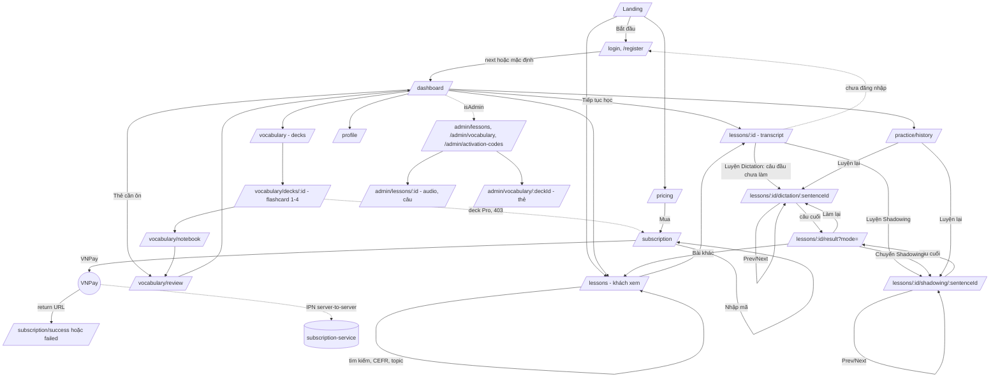

# Đặc tả yêu cầu: Parroto clone (spec hợp nhất)

> Ngày: 2026-10-13. Nguồn: `docs/analysis/parroto-app.md` (site gốc, ký hiệu [OBS]/[INF]) và `docs/analysis/current-project.md` (hiện trạng, bug B1–B9, bảo mật S1–S10).
> Quyết định phạm vi của người dùng: **xây trên tài nguyên sẵn có** (Next.js 14 App Router, Express gateway, 5 Spring Boot service, Postgres DB-per-service, Redis, S3, Azure Speech, VNPay). Tính năng parroto.app mà dự án **chưa có gì** được đưa vào Backlog Phase 2+ ("bổ sung sau"), chỉ liệt kê, không đặc tả sâu.
>
> Quy ước: `FE` = `frontend/src`, `GW` = `api-gateway`, `svc:<tên>` = Spring Boot service. Endpoint ghi theo **path qua gateway**. **NEW** = endpoint nhỏ mới, đặt trong service đã có. Mã yêu cầu dạng `DIC-03` dùng để tham chiếu trong task/PR. Bug mới phát hiện khi viết spec được đánh số tiếp **B10–B11**.

---

## 1. Mục tiêu & phạm vi

### 1.1 Mục tiêu
1. Mọi module đã có chạy được **end-to-end**, không còn bug chặn luồng (đặc biệt Shadowing B1/B2) và các lỗ hổng S1–S10.
2. Trải nghiệm luyện tập **gần parroto.app** trong giới hạn dữ liệu hiện có: điều hướng câu trước/sau, phím tắt, tốc độ phát, gợi ý/lộ từ, Easy/Normal/Hard dạng điền từ, thống kê cuối bài, SRS 4 mức (Again/Hard/Good/Easy).
3. Ứng dụng dùng được trên điện thoại (điều hướng mobile) và có trang lỗi/404.

### 1.2 Phase
| Phase | Nội dung | Ràng buộc |
|---|---|---|
| **Phase 1** | Hoàn thiện/sửa 9 module đã có + nền tảng (mục 3). | **Không đổi schema DB** (không có công cụ migration; `ddl-auto: validate`). Chỉ thêm endpoint NEW nhỏ dùng bảng sẵn có. Không thêm service mới. |
| **Phase 2+** | Backlog tính năng parroto.app chưa có (mục 5). | Cần schema mới / service mới / bên thứ ba; tiền đề chung: thêm Flyway (mục 5, nhóm 0). |

### 1.3 Ngoài phạm vi
Sao chép thương hiệu/nội dung của parroto.app; mã hoá payload kiểu parroto; app mobile native; SEO/blog.

---

## 2. Bảng đối chiếu tính năng

Trạng thái: **Có** = đã chạy đúng · **Có-lỗi** = có nhưng hỏng/sai · **Một phần** = có nền tảng, thiếu chức năng · **Chưa có**.

| # | Tính năng parroto.app | Trạng thái | Ghi chú + file tham chiếu | Phase |
|---|---|---|---|---|
| 1 | Đăng nhập Email/mật khẩu, đăng ký | Có | `app/login`, `app/register`; `POST /auth/login`, `/auth/register` | 1 (polish) |
| 2 | Đăng nhập Google | Có-lỗi | S4: bỏ qua `aud` khi `GOOGLE_CLIENT_ID` rỗng (`GoogleTokenVerifier.java:43`) | 1 |
| 3 | Đăng nhập Apple | Một phần | BE có `/auth/login-apple`, không có UI; `APPLE_CLIENT_ID` không truyền vào compose | 2+ |
| 4 | Duy trì phiên (refresh token) | Có-lỗi | B5 `lib/api.ts:17-27`; S1 refresh token dùng như access token; S2 logout không có hiệu lực ở GW/service khác | 1 |
| 5 | Quên mật khẩu / xác minh email (`/auth/action`) | Chưa có | auth-service không có SMTP/token reset | 2+ |
| 6 | Hồ sơ: đổi CEFR, đổi mật khẩu, xoá TK | Có | `(app)/profile/page.tsx`; số giờ/từ luôn 0 (cột `"user".total_*` không đồng bộ); B4 dòng 74 | 1 |
| 7 | Hồ sơ: avatar, username, ngày sinh, profile công khai `/profile/[id]` | Chưa có | Không có upload avatar / cột username | 2+ |
| 8 | Danh sách bài học + lọc CEFR | Có | `app/lessons/page.tsx`; `GET /content/lessons` | 1 |
| 9 | Lọc theo topic/tag, tìm kiếm bài | Một phần | BE có `topicTag`, `/content/lessons/search`; FE không dùng | 1 |
| 10 | Trang topic `/topics/[slug]`, thumbnail, lượt xem | Chưa có | Bảng `lesson` không có thumbnail/view_count/bảng topic | 2+ |
| 11 | Chi tiết bài + transcript (IPA, bản dịch) + audio | Có-lỗi | `app/lessons/[id]/page.tsx:20` spinner vô hạn (B4); B6 fallback audio | 1 |
| 12 | Dialog chọn chế độ Dictation/Shadowing | Một phần | Có 2 nút mỗi câu; chưa có "Bắt đầu học" theo bài | 1 |
| 13 | Màn Dictation: nghe → gõ → chấm từng từ | Có | `(app)/lessons/[id]/dictation/[sentenceId]/page.tsx`, `POST /practice/dictation/attempt`, `WordDiffView` | 1 |
| 14 | Dictation: câu trước/sau, phím tắt, tốc độ phát, replay | Chưa có (dữ liệu sẵn) | `sentence.start_ms/end_ms/audio_url` đủ | 1 |
| 15 | Dictation: Easy/Normal/Hard dạng điền từ | Một phần | Hiện chỉ là hệ số điểm (`DictationScorer.java:44`), Hard ×1.5 → điểm > 100 (**B10**) | 1 |
| 16 | Dictation: gợi ý/lộ từ, "Show all", "Skip" | Chưa có | Làm được ở FE | 1 |
| 17 | Thống kê cuối bài (điểm, attempts/câu, thời gian) | Chưa có (BE sẵn) | `GET /practice/stats/by-lesson/{id}`, `/practice/lessons/{id}/attempts` chưa dùng | 1 |
| 18 | Video YouTube, Watch mode, phụ đề tuỳ biến | Chưa có | Bài học là audio S3, không có video | 2+ |
| 19 | Ghi chú theo câu (`/my-notes`), báo lỗi phụ đề | Chưa có | Không có bảng | 2+ |
| 20 | Shadowing: ghi âm → chấm phát âm từng từ | Có-lỗi | B1 (`Recorder.tsx:11` vs `ShadowingStorageService.java:52`), B2 (`AzureSpeechClient.java:62`), Safari | 1 |
| 21 | Shadowing: nghe lại bản ghi, accuracy câu | Có-lỗi | B3 (`practice/history/page.tsx:79`), S3 IDOR | 1 |
| 22 | Shadowing: ASR trong trình duyệt (Whisper) | Chưa có | Dự án dùng Azure Speech phía server – giữ nguyên | – (không làm) |
| 23 | Ôn câu sai đến hạn (`/review` câu) | Chưa có | Cần SRS cho câu (bảng mới) | 2+ |
| 24 | Thư viện deck từ vựng, deck Pro | Có | `(app)/vocabulary/page.tsx`, `GET /vocabs/decks` | 1 |
| 25 | Học flashcard theo deck, chấm 4 mức | Có-lỗi | `decks/[id]/page.tsx`; mapping 0/2/3/5 nhưng SM-2 bỏ qua quality khi tính interval (**B11**, `SM2Calculator.java:25-33`) | 1 |
| 26 | Phiên ôn SRS các thẻ đến hạn | Có-lỗi | `vocabulary/review/page.tsx`; cùng B11 | 1 |
| 27 | Sổ tay từ vựng (notebook) | Một phần | `vocabulary/notebook/page.tsx`: không debounce, limit 100 | 1 |
| 28 | Chế độ gõ từ (typing) trong flashcard | Chưa có (dữ liệu sẵn) | `vocab_card.word/meaning` đủ | 1 (tuỳ chọn) |
| 29 | Giới hạn review/ngày | Chưa có | Cần lưu setting user → làm ở FE (localStorage) | 1 (tuỳ chọn) |
| 30 | Group trong deck, sổ từ cá nhân deck/group/card, import | Chưa có | Không có bảng group/user deck | 2+ |
| 31 | Từ điển `/dictionary/[word]`, click từ → Word info | Chưa có | Không có nguồn dữ liệu từ điển | 2+ |
| 32 | Game từ vựng (11 game), Vocab Battle PvP | Chưa có | | 2+ |
| 33 | Dashboard: thống kê, streak | Có | `(app)/dashboard/page.tsx`; không dùng `accuracy.weekly` | 1 |
| 34 | Heatmap hoạt động, longest streak | Một phần | `longestStreak` có trong `StatsResponse`; heatmap cần aggregate theo ngày (NEW) | 1 |
| 35 | Lịch sử luyện tập | Có-lỗi | `practice/history/page.tsx`: thiếu tên bài/ngày, B3 | 1 |
| 36 | Lỗi hay gặp (Smart Error Review) | Một phần | `GET /practice/stats/trending-errors` chưa dùng | 1 |
| 37 | Đo thời gian học thật (heartbeat) | Chưa có | Hiện tính từ `practice_attempt.duration` | 2+ |
| 38 | Check-in, XP/level, kim cương, missions, leaderboard, shop, rank kỹ năng | Chưa có | | 2+ |
| 39 | Bảng giá, mua Premium | Có | `app/pricing`, `(app)/subscription`; VNPay | 1 |
| 40 | Xác minh thanh toán server-to-server (IPN), đối chiếu số tiền | Có-lỗi | S8 `SubscriptionService.handlePaymentCallback` | 1 |
| 41 | Mã kích hoạt Premium | Có-lỗi | Có `POST /subscriptions/activate-code` nhưng không seed/không API tạo mã | 1 |
| 42 | Premium có hiệu lực ngay sau mua | Có-lỗi | B8 `PremiumClient.java:44` cache 5 phút | 1 |
| 43 | Bài học Pro (`is_pro`) | Chưa có | `lesson` không có cột `is_pro` | 2+ |
| 44 | Paddle, SePay/VietQR, IAP, khuyến mãi (promo), gói Lifetime | Chưa có | Dự án dùng VNPay | 2+ |
| 45 | Admin: CRUD bài học, upload audio, thêm câu | Một phần | Không sửa bài/câu; `UpdateLessonRequest` lệch payload FE; upload 5MB | 1 |
| 46 | Admin: deck/thẻ từ vựng | Một phần | Không xem/sửa/xoá thẻ; thiếu field `exampleVi/partOfSpeech/…` | 1 |
| 47 | Admin: mã kích hoạt | Chưa có (bảng sẵn) | Bảng `activation_code` có sẵn | 1 |
| 48 | Admin: quản lý người dùng, kiểm duyệt cộng đồng | Chưa có | | 2+ |
| 49 | Layout sidebar + topbar (streak, PRO) | Có | `components/layout/{AppShell,Sidebar,Topbar}.tsx` | 1 |
| 50 | Điều hướng mobile | Chưa có | B9 `Sidebar.tsx:36` `hidden md:flex` | 1 |
| 51 | Trang 404/lỗi | Chưa có | Thiếu `not-found.tsx`, `error.tsx` | 1 |
| 52 | Dark mode | Chưa có | | 2+ |
| 53 | Đa ngôn ngữ 17 locale | Chưa có | UI chỉ tiếng Việt | 2+ |
| 54 | Bài học từ YouTube (AI), community lessons, passive listening | Chưa có | | 2+ |
| 55 | Thi thử IELTS/TOEIC | Chưa có | | 2+ |
| 56 | Cộng đồng: forum, chat, bạn bè, voice chat, feedback, thông báo | Chưa có | | 2+ |
| 57 | Affiliate/referral, quảng cáo | Chưa có | | 2+ |

---

## 3. Spec Phase 1

Mỗi yêu cầu có mã; mỗi acceptance criterion (AC) là một mục checklist kiểm thử được (thủ công hoặc tự động). Mức ưu tiên: **M** = must, **S** = should, **C** = could.

### 3.0 Nền tảng / hạ tầng (cross-cutting)

| Mã | Ưu tiên | Yêu cầu | Tham chiếu |
|---|---|---|---|
| X-01 | M | Chỉ publish cổng `frontend:3000` và `api-gateway:8000` ra host; 8001–8005, 5432, 6379 chỉ trong mạng docker (cho phép override qua `docker-compose.override.yml` khi dev). | S5 |
| X-02 | M | `/internal/**` chỉ chấp nhận request có header `X-Internal-Token` khớp env `INTERNAL_TOKEN` (auth, subscription). | S5 |
| X-03 | M | Bỏ fallback JWT secret trong code; GW và service **fail khi khởi động** nếu `JWT_SECRET` rỗng hoặc < 32 ký tự. | S7 |
| X-04 | S | `init-db.sql` đọc mật khẩu role từ biến môi trường (script `docker-entrypoint-initdb.d/*.sh` dùng `psql -v`), `JWT_*_EXPIRY_SECONDS` lấy từ `.env`. | S6, nợ `docker-compose.yml:81-82` |
| X-05 | S | Dockerfile Java dùng JDK/JRE 21; GW có `package-lock.json` + `npm ci`. | nợ kỹ thuật |
| X-06 | S | Thay Redis `KEYS` bằng `SCAN` trong `CacheService.invalidateByPattern` (4 service). | nợ kỹ thuật |
| X-07 | S | Tối thiểu: `.eslintrc` (next/core-web-vitals), bỏ `ignoreDuringBuilds`; `tsconfig.tsbuildinfo` vào `.gitignore`; test JUnit cho `DictationScorer`, `SM2Calculator`, `StreakCalculator`; CI chạy `tsc --noEmit`, `next lint`, `mvn test`. | §6 hiện trạng |
| X-08 | C | Gom hằng số FE dùng chung: `CEFR_LEVELS`, `TOPIC_TAGS`, `TOPIC_ICONS`, component `Pagination`, `ErrorState`. | nợ kỹ thuật |

AC:
- [ ] `docker compose ps` chỉ hiển thị cổng host 3000 và 8000 (cấu hình mặc định).
- [ ] `curl http://auth-service:8001/internal/users/<id>` từ container khác không có `X-Internal-Token` → 401/403; có token đúng → 200.
- [ ] Khởi động GW với `JWT_SECRET=` → process thoát với log lỗi rõ ràng.
- [ ] Đổi `AUTH_DB_PASSWORD` trong `.env`, tạo volume mới → auth-service vẫn kết nối DB.
- [ ] CI xanh với 3 test class nêu trên.

### 3.1 Auth & Profile

**Màn hình:** `/login`, `/register`, `/profile` (giữ route).
**Luồng:** Landing → `/login` (hoặc `/register`) → về `?next=` nếu có, mặc định `/dashboard`. Truy cập route `(app)` khi chưa đăng nhập → `/login?next=<route>`.
**Dữ liệu:** `"user"` (auth_db); store `parroto-auth` (token, refreshToken).
**API:** `POST /auth/register|login|login-google|refresh-token|logout`, `GET/PUT /auth/profile`, `PUT /auth/change-password`, `DELETE /auth/account`, `GET /practice/stats`, `GET /vocabs/user/stats`.

| Mã | Ưu tiên | Yêu cầu | Tham chiếu |
|---|---|---|---|
| AUTH-01 | M | Interceptor axios: khi 401 và có refreshToken → gọi `/auth/refresh-token` **một lần** (hàng đợi cho request song song), retry request gốc; refresh lỗi → `clearAuth` + `/login?next=`. | B5 |
| AUTH-02 | M | GW + mọi `JwtValidator`/`JwtAuthFilter` chỉ chấp nhận `type=access`; refresh token chỉ dùng ở `/auth/refresh-token`. | S1 |
| AUTH-03 | M | Kiểm tra blacklist `jti` (Redis, cùng key format auth-service) ở GW (thêm client Redis) và 4 service còn lại. | S2 |
| AUTH-04 | M | Google login: nếu `GOOGLE_CLIENT_ID` rỗng → trả 503 "Google login chưa cấu hình", không bỏ qua `aud`. Tương tự Apple. | S4 |
| AUTH-05 | M | `AuthGuard` giữ `next` khi redirect; `/login` đã đăng nhập → chuyển `/dashboard`. | UX |
| AUTH-06 | S | Profile: số giờ học/số từ đã học lấy từ `GET /practice/stats.totalHoursLearned` và `GET /vocabs/user/stats` (không dùng cột `"user".total_*`). | hiện trạng §4 |
| AUTH-07 | S | Ẩn form đổi mật khẩu nếu `authProvider != 'local'` (hoặc giá trị tương đương); BE trả 400 nếu gọi. | hiện trạng §2 |
| AUTH-08 | M | Profile: trạng thái lỗi thay spinner vô hạn (dùng `ErrorState`). | B4 `profile/page.tsx:74` |

AC:
- [ ] Đặt `JWT_EXPIRY_SECONDS=60`, chờ 61s, thao tác bất kỳ → request thành công, không bị đá ra `/login`; Network có đúng 1 lời gọi `/auth/refresh-token` dù 3 request song song cùng 401.
- [ ] Dùng refresh token làm `Authorization: Bearer` gọi `GET /practice/stats` → 401.
- [ ] Logout rồi gọi lại `GET /practice/stats`, `GET /vocabs/user/stats`, `GET /subscriptions/user` bằng token cũ → 401 cả ba.
- [ ] `GOOGLE_CLIENT_ID` rỗng: `POST /auth/login-google` với ID token hợp lệ của app khác → 503; nút Google không hiển thị.
- [ ] Mở `/vocabulary/review` khi chưa đăng nhập → `/login?next=%2Fvocabulary%2Freview` → đăng nhập xong quay lại đúng trang.
- [ ] Profile hiển thị số giờ/từ khớp Dashboard.
- [ ] Tài khoản Google không thấy form đổi mật khẩu.

### 3.2 Lessons / Content

**Màn hình:**
| Route | Mô tả |
|---|---|
| `/lessons` | Danh sách: ô tìm kiếm, chip CEFR, chip topic, card bài (tiêu đề, CEFR, topic, thời lượng, số câu), phân trang. |
| `/lessons/[id]` | Chi tiết: header (tiêu đề, CEFR, topic, thời lượng, mô tả), audio cả bài, nút **"Luyện Dictation"** / **"Luyện Shadowing"** (vào câu đầu tiên chưa làm), transcript (mỗi câu: thứ tự, text, IPA, bản dịch – toggle hiện/ẩn IPA và dịch, ✓ nếu đã làm, nút nghe câu, nút D/S). |
| `not-found` cho bài | Bài không tồn tại/đã xoá → "Không tìm thấy bài học" + link `/lessons`. |

**Dữ liệu:** `lesson`, `sentence` (content_db); attempts của user (practice_db).
**API:** `GET /content/lessons?cefrLevel&topicTag&page&limit`, `GET /content/lessons/search?q`, `GET /content/lessons/{id}`, `GET /content/lessons/{id}/audio`, `GET /content/sentences/{id}/audio`, `GET /practice/lessons/{lessonId}/attempts` (chỉ khi đăng nhập).

| Mã | Ưu tiên | Yêu cầu | Tham chiếu |
|---|---|---|---|
| LES-01 | M | Mọi page dùng `isError` → `ErrorState` (404 → thông báo không tìm thấy; lỗi khác → "Thử lại" gọi `refetch`). | B4 (`lessons/[id]/page.tsx:20` và các file liệt kê) |
| LES-02 | M | Tìm kiếm: ô search debounce 300ms, ≥2 ký tự gọi `/content/lessons/search?q`, rỗng → danh sách thường; giữ state trong query string (`?q=&level=&topic=&page=`). | BE có sẵn |
| LES-03 | M | Chip topic dùng `topicTag` với danh sách `TOPIC_TAGS` dùng chung với admin. | BE có sẵn |
| LES-04 | M | Nút "Luyện Dictation/Shadowing" theo bài: điều hướng tới câu đầu tiên chưa có attempt ở mode đó (dựa `/practice/lessons/{id}/attempts`), hết câu → câu 1. Khách chưa đăng nhập → `/login?next=`. | parroto 7.1 |
| LES-05 | S | Transcript: toggle IPA / bản dịch (nhớ lựa chọn ở localStorage), dấu ✓ câu đã làm, điểm tốt nhất mỗi câu. | parroto 7.1 |
| LES-06 | M | `AudioPlayer` hiển thị fallback khi audio lỗi (bắt `error` trên `<source>` hoặc dùng `src` trực tiếp). | B6 |
| LES-07 | M | `addSentences` (và update/delete câu) xoá cache `lessons:list:*` và `lesson:{id}`. | B7 `LessonService.java:123` |
| LES-08 | S | Seed: thay `audio_url` seed bằng file có thật (bucket dev/MinIO hoặc file mẫu) để demo chạy được. | nợ seed |

AC:
- [ ] `/lessons/00000000-0000-0000-0000-000000000000` hiển thị "Không tìm thấy bài học" trong ≤ 3s, không spinner vô hạn; tắt content-service → "Thử lại" hiển thị.
- [ ] Gõ "travel" → tối đa 1 request search sau khi ngừng gõ 300ms; reload trang giữ nguyên kết quả nhờ query string.
- [ ] Chọn chip topic X + CEFR B1 → mọi card hiển thị đều có topic X và B1.
- [ ] Đã làm câu 1–3 Dictation → bấm "Luyện Dictation" mở câu 4.
- [ ] Audio URL hỏng → hiện "Audio chưa khả dụng".
- [ ] Admin thêm câu → `/lessons` hiện `sentenceCount` mới ngay (không chờ 24h).

### 3.3 Dictation

**Màn hình:** `/lessons/[id]/dictation/[sentenceId]` (giữ route, chuyển câu bằng `router.replace` để không lặp history) + `/lessons/[id]/result?mode=dictation` (**route FE mới**, thống kê cuối bài).
**Bố cục:** thanh tiến độ "Câu n/N"; player câu (Play/Pause, Replay, Prev, Next, tốc độ 0.5/0.75/1/1.25/1.5); vùng nhập; panel kết quả (`WordDiffView`, IPA, bản dịch); nút "Thêm từ vào sổ tay" (Phase 2 – bỏ qua); chọn chế độ Easy/Normal/Hard trong popover Settings.
**Phát audio câu:** ưu tiên `sentence.audioUrl` qua `/content/sentences/{id}/audio`; nếu null → audio bài, `currentTime = startMs/1000`, dừng tại `endMs` ("Auto stop").
**Dữ liệu:** `sentence.text/ipa/translationVi/startMs/endMs/audioUrl`; `practice_attempt` (mode=dictation).
**API:** `GET /content/lessons/{id}`, `POST /practice/dictation/attempt` (`{lessonId, sentenceId, typedText, difficulty}`), `GET /practice/stats/by-lesson/{lessonId}`, `GET /practice/lessons/{lessonId}/attempts`.

**Chế độ khó (FE, từ `sentence.text`):** tách từ theo khoảng trắng, giữ dấu câu ngoài ô.
| Chế độ | Ô trống | Quy tắc chọn từ điền sẵn (deterministic theo `sentenceId` để reload không đổi) |
|---|---|---|
| Easy | ~50% từ | điền sẵn từ ở vị trí chẵn |
| Normal | ~75% từ | điền sẵn mỗi từ thứ 4 (vị trí 0, 4, 8…) |
| Hard | 100% | không điền sẵn; 1 ô textarea tự do (giữ hành vi hiện tại) |

Easy/Normal: mỗi ô từ là input riêng; `Space` → ô kế, `Backspace` ở ô rỗng → ô trước. Khi nộp, FE ghép từ điền sẵn + từ gõ thành `typedText` đầy đủ.

**Phím tắt** (hiển thị trong tooltip/"?"):
| Phím | Hành động |
|---|---|
| `Tab` (khi không ở cuối form) hoặc `Ctrl+Space` | Play/Pause |
| `` ` `` hoặc `Ctrl+R` | Replay câu |
| `Enter` | Nộp / sang câu kế nếu đã đúng |
| `Shift+→` / `Ctrl/⌘+→` | Câu kế |
| `Shift+←` / `Ctrl/⌘+←` | Câu trước |
| `Ctrl+H` | Gợi ý 1 từ |

| Mã | Ưu tiên | Yêu cầu | Tham chiếu |
|---|---|---|---|
| DIC-01 | M | Lỗi tải bài → `ErrorState` (không spinner vô hạn). | B4 dòng 32 |
| DIC-02 | M | Prev/Next câu + thanh "Câu n/N"; câu cuối → nút "Hoàn thành bài" → `/lessons/[id]/result?mode=dictation`. | parroto 7.1 |
| DIC-03 | M | Phát theo câu (sentence audio hoặc segment start/end của audio bài, auto stop). | dữ liệu sẵn |
| DIC-04 | M | Tốc độ phát 0.5–1.5 (`playbackRate`), lưu localStorage, áp cho mọi câu. | parroto |
| DIC-05 | M | Phím tắt theo bảng trên; không kích hoạt khi đang mở modal. | parroto 7.1 |
| DIC-06 | M | Easy/Normal/Hard dạng điền từ theo bảng trên; chế độ lưu localStorage. | parroto 7.1 |
| DIC-07 | M | Sửa **B10**: điểm `score` luôn trong 0–100. Đổi hệ số `DictationScorer.weightedScore`: Easy 0.6, Normal 0.8, Hard 1.0 (score = accuracy × hệ số). | `DictationScorer.java:44` |
| DIC-08 | S | Gợi ý: click ô (hoặc `Ctrl+H`) lộ 1 từ; "Hiện tất cả"; "Bỏ qua câu". Từ bị lộ hiển thị màu khác; số từ lộ, số lần replay, số lần nộp, thời gian/câu được đếm ở FE (sessionStorage theo lessonId) để dùng cho màn kết quả. Từ lộ **được tính sai** khi chấm: FE gửi chuỗi rỗng ở vị trí đó. | parroto 7.1 |
| DIC-09 | M | Kết quả nộp: "Chính xác!" (accuracy = 100) + âm thanh/rung nhẹ, ngược lại "Chưa đúng, thử lại" và cho nộp lại; hiển thị IPA + bản dịch sau khi nộp. | parroto 7.1 |
| DIC-10 | M | Màn kết quả `/lessons/[id]/result?mode=dictation`: Final score (TB điểm tốt nhất mỗi câu) + nhãn Xuất sắc ≥ 90 / Tốt ≥ 70 / Cần cải thiện; số câu đã làm/N; TB lần nộp/câu, TB replay/câu, TB từ lộ/câu, tổng thời gian (từ sessionStorage, nếu có); danh sách câu sai nhiều nhất; nút "Làm lại bài", "Chuyển sang Shadowing", "Bài khác" (cùng CEFR). | parroto 7.1, BE `stats/by-lesson` |

AC:
- [ ] Ở câu 1 nhấn `Shift+→` → URL đổi sang sentenceId câu 2, Back của trình duyệt về trang trước bài (không về câu 1).
- [ ] Câu có `audioUrl = null`: Play chỉ phát đoạn `startMs–endMs` của audio bài rồi tự dừng (sai số ≤ 300ms).
- [ ] Đặt tốc độ 0.75, chuyển câu, reload → vẫn 0.75.
- [ ] Easy: câu 10 từ hiển thị 5 ô trống; Normal: 7 ô (10 từ, điền sẵn vị trí 0/4/8); Hard: 1 textarea. Reload không đổi vị trí ô.
- [ ] Easy: điền đúng hết → request có `typedText` bằng nguyên câu (bỏ qua hoa/thường, dấu câu) và `accuracy=100`.
- [ ] Hard, gõ đúng 100% → `score = 100`; không lượt nào trong `practice_attempt` có `score > 100` (unit test `DictationScorer`).
- [ ] Lộ 2 từ rồi nộp → `WordDiffView` đánh dấu 2 từ đó là sai; màn kết quả hiển thị "TB từ lộ/câu" > 0.
- [ ] Hoàn thành câu cuối → màn kết quả hiển thị đủ các chỉ số trên, số liệu "câu đã làm" khớp `GET /practice/stats/by-lesson/{id}`.
- [ ] Mở modal bất kỳ, nhấn `Enter` → không nộp bài.

### 3.4 Shadowing

**Màn hình:** `/lessons/[id]/shadowing/[sentenceId]` (giữ route, Prev/Next giống DIC-02), `/lessons/[id]/result?mode=shadowing`.
**Luồng:** nghe câu → Record (hoặc `Shift+\``) → Stop → "Đang chấm…" → kết quả từng từ (Đúng ≥ 80 / Gần đúng 60–79 / Thử lại < 60, dùng `PhonemeScoreView`) → nghe lại bản ghi (`Space`) → câu kế.
**Dữ liệu:** `practice_attempt` (mode=shadowing, `word_scores`, `audio_recording_url` = S3 key).
**API:** `POST /practice/shadowing/request-upload-url` → `PUT <presigned>` → `POST /practice/shadowing/attempt`; `GET /practice/shadowing/{attemptId}/recording` (stream, cần Bearer).

| Mã | Ưu tiên | Yêu cầu | Tham chiếu |
|---|---|---|---|
| SHA-01 | M | `Recorder` ghi âm qua Web Audio (`getUserMedia` + `AudioWorklet`/`ScriptProcessor`), resample **16 kHz mono PCM 16-bit**, đóng gói **WAV** ở client; không phụ thuộc `MediaRecorder` mime → chạy trên Chrome, Firefox, Safari. | B1, B2 |
| SHA-02 | M | PUT presigned với `Content-Type: audio/wav` khớp chữ ký (`ShadowingStorageService.java:52`); Azure nhận đúng định dạng WAV PCM 16k (`AzureSpeechClient.java:62`). | B1, B2 |
| SHA-03 | M | Giới hạn bản ghi 30s (tự stop), từ chối < 0.5s; lỗi quyền micro → hướng dẫn cấp quyền; lỗi upload/chấm → toast + cho thử lại, không mất bản ghi. | parroto 7.2 |
| SHA-04 | M | `GET /practice/shadowing/{attemptId}/recording` chỉ trả cho chủ sở hữu (khác user → 404). | S3 |
| SHA-05 | M | Nghe lại bản ghi: FE gọi endpoint recording bằng axios (`responseType: 'blob'`) → `URL.createObjectURL` → `<audio>`; dùng cho màn Shadowing và `/practice/history`. Bản ghi vừa thu phát trực tiếp từ blob local. | B3 |
| SHA-06 | S | Mỗi câu hiển thị "Lần gần nhất" và "Trung bình" accuracy (từ `/practice/lessons/{id}/attempts` lọc mode). | parroto 7.2 |
| SHA-07 | S | Màn kết quả shadowing: điểm phát âm TB, số câu đã shadow/N, top từ phát âm kém. | parroto 7.2 |
| SHA-08 | M | Lỗi tải bài → `ErrorState`. | B4 dòng 28 |

AC:
- [ ] Chrome, Firefox, Safari (macOS/iOS): ghi 3s → upload 200 → nhận điểm từng từ (môi trường có cấu hình Azure + S3).
- [ ] Không cấu hình S3/Azure (chế độ mock, Q6): cùng luồng ghi → upload (204, lưu local) → nhận điểm mô phỏng từng từ, UI hiển thị nhãn "Chế độ demo".
- [ ] File trên S3 có header `RIFF…WAVE`, sample rate 16000, 1 kênh.
- [ ] User B gọi `GET /practice/shadowing/{attemptId của A}/recording` → 404.
- [ ] `/practice/history` mở chi tiết lượt shadowing → phát được bản ghi.
- [ ] Từ chối quyền micro → hiện hướng dẫn, không crash; ghi quá 30s → tự dừng.
- [ ] Mất mạng khi upload → toast lỗi, nút "Gửi lại" dùng lại bản ghi cũ.

### 3.5 Vocabulary (SRS + notebook)

**Màn hình:** `/vocabulary` (danh sách deck), `/vocabulary/decks/[id]` (học flashcard), `/vocabulary/review` (ôn thẻ đến hạn), `/vocabulary/notebook` (sổ tay).
**Dữ liệu:** `vocab_deck`, `vocab_card`, `user_vocab` (SM-2: `interval_days, ease_factor, repetitions, quality, next_review_at`).
**API:** `GET /vocabs/decks`, `GET /vocabs/decks/{id}/cards?searchWord&page&limit`, `GET /vocabs/user/review-queue`, `POST /vocabs/user/review` (`{userVocabId, quality 0–5}`), `GET /vocabs/user/stats`, `GET /vocabs/user/learned?searchWord&page&limit`, `POST /vocabs/user/add-from-lesson`, `DELETE /vocabs/user/{id}`.

**Mapping đánh giá 1–4 → SM-2** (một hằng số dùng chung FE `SRS_RATINGS`; BE vẫn nhận `quality` 0–5 để tương thích):
| Phím | Nút | quality | Hành vi lịch (sửa `SM2Calculator` + `ReviewService.submitReview`) |
|---|---|---|---|
| 1 | Again / Học lại | 1 | `repetitions = 0`, `interval_days = 1`, `next_review_at = now + 1 ngày` |
| 2 | Hard / Khó | 3 | `interval = I`, `repetitions + 1` |
| 3 | Good / Tốt | 4 | `interval = I`, `repetitions + 1` |
| 4 | Easy / Dễ | 5 | `interval = I`, `repetitions + 1` |

*(Cập nhật 2026-10-13 theo quyết định Q3: dùng **SM-2 chuẩn**, thay cho biến thể Hard ×0.6 / Easy ×1.3 / Again 10 phút trước đây.)* Trong đó `I` = interval SM-2 chuẩn: reps 0 → 1, reps 1 → **6**, reps > 1 → `round(prevInterval × EF)` (EF trước khi cập nhật). EF cập nhật theo công thức SM-2 `EF + (0.1 − (5−q)(0.08 + (5−q)·0.02))`, floor 1.3, áp dụng cho cả 4 mức. Hard/Good/Easy cho cùng interval ở lần này, khác nhau qua EF (ảnh hưởng các lần sau). Chi tiết: `docs/architecture.md` §4.6. Nhãn gợi ý trên nút hiển thị interval thực tính ở FE bằng cùng công thức (dùng `intervalDays/easeFactor/repetitions` từ review-queue).

| Mã | Ưu tiên | Yêu cầu | Tham chiếu |
|---|---|---|---|
| VOC-01 | M | Sửa **B11**: quality ảnh hưởng interval theo bảng trên (hiện tại interval chỉ phụ thuộc repetitions; "Again" không reset). Unit test bao phủ 4 mức. | `SM2Calculator.java:25-33`, `ReviewService.java:50-60` |
| VOC-02 | M | Thống nhất 4 nút + phím `1–4`, `Space`/`Enter` = lật thẻ ở cả `decks/[id]` và `review` (bỏ 2 mảng hard-code 0/2/3/5). | `decks/[id]/page.tsx:24-27`, `review/page.tsx:16-19` |
| VOC-03 | M | `add-from-lesson` kiểm tra deck của thẻ: deck `isProOnly` và user không premium → 403. | S9 `ReviewService.java:99` |
| VOC-04 | M | Bỏ giới hạn cứng: `decks/[id]` tải thẻ theo trang (limit 50, "Tải thêm"/infinite); trạng thái "đã học" kiểm tra bằng danh sách learned phân trang hoặc theo `cardId` trong trang hiện tại. | nợ `decks/[id]/page.tsx:43,48` |
| VOC-05 | M | Notebook: debounce 300ms, phân trang (limit 20), hiển thị `nextReviewAt`, `interval`, xác nhận trước khi xoá. | nợ `notebook/page.tsx:20` |
| VOC-06 | S | Phiên ôn: thanh tiến độ, kết thúc phiên hiện tổng kết (số thẻ, phân bố Again/Hard/Good/Easy), "Không còn thẻ đến hạn – lần ôn kế tiếp lúc …". | parroto 7.3 |
| VOC-07 | S | Flashcard hiển thị đủ `word, ipa, partOfSpeech, meaning, example, exampleVi, image`, nút phát âm (`audioUrl`, fallback `speechSynthesis` en-US). | dữ liệu sẵn |
| VOC-08 | S | Deck Pro với user free: card nâng cấp → `/subscription` (giữ hành vi 403 hiện có); sau khi mua, truy cập được ngay (xem SUB-04). | B8 |
| VOC-09 | C | Chế độ gõ từ: hiện `meaning` (+ ví dụ che từ) → gõ `word` → `Enter` kiểm tra; đúng → gợi ý chấm Good, sai → Again. | parroto 7.3 |
| VOC-10 | C | Giới hạn thẻ ôn/ngày (1–1000, mặc định 100) lưu localStorage, phiên ôn cắt theo giới hạn. | parroto 7.3 |

AC:
- [ ] Unit test: thẻ reps=3, interval=10, EF=2.5 → Again: interval 1 ngày, reps=0, EF=1.96; Hard: 25 (EF 2.36); Good: 25 (EF 2.50); Easy: 25 (EF 2.60); thẻ reps=1 chấm Good → 6 ngày.
- [ ] Bấm phím `3` khi thẻ đã lật → gửi `quality=4`; khi chưa lật → chỉ lật thẻ.
- [ ] Ôn "Again" một thẻ → `repetitions` về 0 và thẻ đến hạn lại sau 1 ngày (trước đây không reset).
- [ ] User free `POST /vocabs/user/add-from-lesson` với cardId thuộc deck Pro → 403.
- [ ] Deck có 150 thẻ → xem được thẻ thứ 150.
- [ ] Notebook: gõ "app" nhanh → 1 request; có phân trang khi > 20 từ.
- [ ] Badge "cần ôn" ở Sidebar/Topbar giảm ngay sau mỗi lần chấm (invalidate query `vocab-stats`).

### 3.6 Practice history / Stats / Streak (Dashboard)

**Màn hình:** `/dashboard`, `/practice/history`.
**Dữ liệu:** `practice_attempt`; `user_vocab` (stats từ vựng).
**API:** `GET /practice/stats`, `GET /practice/streak`, `GET /practice/stats/trending-errors`, `GET /practice/attempts?lessonId&mode&page&limit`, `GET /practice/attempts/{id}`, `GET /vocabs/user/stats`, `GET /content/lessons/{id}`; **NEW** `GET /practice/stats/activity?days=90` → `[{date: 'YYYY-MM-DD', attempts, minutes}]` (aggregate `practice_attempt` theo ngày, timezone `Asia/Ho_Chi_Minh`).

| Mã | Ưu tiên | Yêu cầu | Tham chiếu |
|---|---|---|---|
| PRA-01 | M | Dashboard: thẻ "Streak hiện tại / dài nhất", tổng giờ học, accuracy Dictation/Shadowing, bài đã hoàn thành, số từ đã học, số thẻ cần ôn (link `/vocabulary/review`), "Tiếp tục học" (bài có attempt gần nhất). | `StatsResponse` |
| PRA-02 | M | Biểu đồ xu hướng accuracy tuần từ `accuracy.weekly/dates` (SVG/CSS thuần, không thêm thư viện nặng). | hiện chưa dùng |
| PRA-03 | S | Heatmap 90 ngày từ NEW `/practice/stats/activity`; ô tô màu theo số attempts; tooltip ngày + số lượt. | parroto dashboard |
| PRA-04 | S | Widget "Từ hay sai" từ `/practice/stats/trending-errors` (top 10). | Smart Error Review |
| PRA-05 | M | History: cột tên bài (react-query `useQueries` theo `lessonId` duy nhất, cache), ngày giờ (`createdAt` – bổ sung vào type `AttemptSummary`), mode, độ khó, điểm; lọc mode; link "Luyện lại" về câu tương ứng. | hiện trạng §2 |
| PRA-06 | M | Modal chi tiết: diff từ (dictation) / điểm phát âm + phát lại bản ghi (shadowing, SHA-05). | B3 |
| PRA-07 | S | Streak: định nghĩa = số ngày liên tiếp (theo `Asia/Ho_Chi_Minh`) có ≥ 1 attempt practice; Topbar dùng `/practice/streak`. | `StreakCalculator` |

AC:
- [ ] Làm 1 câu dictation hôm nay, 1 câu hôm qua (seed) → Dashboard streak = 2; Topbar hiển thị 🔥 2.
- [ ] Biểu đồ tuần hiển thị đủ số điểm bằng `accuracy.dates.length`.
- [ ] `GET /practice/stats/activity?days=90` trả đúng 90 phần tử (ngày không hoạt động = 0), chỉ dữ liệu của user gọi; `days > 365` → 400.
- [ ] History hiển thị tên bài và ngày giờ cho mọi dòng; với 20 dòng cùng 3 bài → tối đa 3 request `GET /content/lessons/{id}`.
- [ ] Attempt 23:30 ngày D (giờ VN) được tính vào ngày D trên heatmap/streak.

### 3.7 Subscription / Premium

**Màn hình:** `/pricing` (public), `/subscription` (gói hiện tại, mua, mã kích hoạt, lịch sử giao dịch), `/subscription/success`, `/subscription/failed`.
**Dữ liệu:** `plan`, `subscription`, `payment_transaction`, `activation_code`.
**API:** `GET /subscriptions/plans`, `GET /subscriptions/user`, `POST /subscriptions/create-payment`, `GET /subscriptions/payment-callback`, `POST /subscriptions/activate-code`, `GET /subscriptions/transactions`; **NEW** `GET /subscriptions/vnpay-ipn` (public, GW route không auth, trả JSON `{RspCode, Message}` theo chuẩn VNPay).

| Mã | Ưu tiên | Yêu cầu | Tham chiếu |
|---|---|---|---|
| SUB-01 | M | Callback & IPN: kiểm tra chữ ký, `vnp_Amount == transaction.amount × 100`, trạng thái chưa xử lý (idempotent); sai số tiền → `failed`, không cấp premium. | S8 |
| SUB-02 | M | NEW IPN endpoint xử lý cập nhật giao dịch server-to-server; return URL chỉ hiển thị/redirect. | S8 |
| SUB-03 | M | `/subscription/success` gọi `GET /subscriptions/user` (poll tối đa 10s) để hiển thị trạng thái thật: "Đã kích hoạt đến <ngày>" hoặc "Đang xử lý". | hiện trạng §2 |
| SUB-04 | M | Khi kích hoạt premium (thanh toán hoặc mã) subscription-service xoá key Redis `premium:{userId}` (Redis dùng chung) để vocabulary-service đọc lại ngay. | B8 `PremiumClient.java:31,44` |
| SUB-05 | M | Mã kích hoạt cộng dồn vào hạn hiện có (nếu đang active, `end_at += duration`); mã hết hạn/đã dùng → 400 với thông điệp rõ. | parroto §6 |
| SUB-06 | S | `/pricing` dùng `PublicHeader`; nút mua khi chưa đăng nhập → `/login?next=/subscription`. Hiển thị so sánh Free vs Premium theo `plan.features`. | hiện trạng §2 |
| SUB-07 | S | Bỏ `autoRenew` khỏi FE type/UI (không có cột); ghi rõ "Thanh toán 1 lần, không tự gia hạn". | hiện trạng §4 |

AC:
- [ ] Giả lập callback với `vnp_Amount` khác giá gói (chữ ký hợp lệ) → giao dịch `failed`, `subscription` không đổi.
- [ ] Gọi IPN 2 lần cùng `vnp_TxnRef` → lần 2 trả `RspCode=02` (đã xử lý), không tạo 2 subscription.
- [ ] Kích hoạt mã → mở deck Pro trong ≤ 5s không bị 403.
- [ ] User đang có premium đến ngày D, nhập mã 30 ngày → hạn mới D+30.
- [ ] Mã đã dùng → 400 "Mã đã được sử dụng".

### 3.8 Admin

**Màn hình:** `/admin/lessons`, `/admin/lessons/[id]`, `/admin/vocabulary`, **`/admin/vocabulary/[deckId]`** (mới), **`/admin/activation-codes`** (mới).
**Quyền:** `profile.isAdmin` (env `ADMIN_EMAILS`); BE giữ `AdminGuard`.
**API:** `GET/POST/PUT/DELETE /content/lessons[/{id}]`, `POST /content/lessons/{id}/upload-audio`, `POST /content/lessons/{id}/sentences`; **NEW** `PUT /content/lessons/{id}/sentences/{sentenceId}`, **NEW** `DELETE /content/lessons/{id}/sentences/{sentenceId}`; `GET/POST/DELETE /vocabs/decks`, `GET/POST /vocabs/decks/{id}/cards`, `PUT /vocabs/cards/{id}`; **NEW** `DELETE /vocabs/cards/{id}` (cập nhật `card_count`); **NEW** `POST /subscriptions/admin/activation-codes` (`{planId, quantity ≤ 500, expiresAt?}` → danh sách code), **NEW** `GET /subscriptions/admin/activation-codes?used&page&limit`.

| Mã | Ưu tiên | Yêu cầu | Tham chiếu |
|---|---|---|---|
| ADM-01 | M | Guard client: layout `(app)/admin` kiểm tra `isAdmin`, không phải admin → trang 403/redirect `/dashboard`; Sidebar chỉ hiện mục admin khi admin (đã có). | S10 |
| ADM-02 | M | Sửa bài học: form gửi đúng `UpdateLessonRequest` (`title, description, topicTag, cefrLevel`); sửa type `contentApi.updateLesson`. | lệch payload §3.3 |
| ADM-03 | M | Sửa/xoá câu (text, ipa, translationVi, startMs, endMs, sentenceOrder) qua 2 endpoint NEW; xoá cache (LES-07). | backend chưa có |
| ADM-04 | M | Nâng `max-file-size`/`max-request-size` lên 50MB, validate mime `audio/*` ở FE + BE. | `content-service application.yml:25` |
| ADM-05 | M | `/admin/vocabulary/[deckId]`: liệt kê thẻ (phân trang, search `searchWord`), thêm/sửa/xoá thẻ với đủ field `word, meaning, ipa, partOfSpeech, example, exampleVi, audioUrl, imageUrl`; thêm `partOfSpeech` vào FE `CardInput`. | `updateCard` chưa dùng |
| ADM-06 | M | `/admin/activation-codes`: tạo lô mã theo gói, xem danh sách (đã dùng/chưa, người dùng, ngày), copy/export CSV. | bảng `activation_code` |
| ADM-07 | S | `vocab_deck.created_by` gán userId admin khi tạo. | hiện trạng §4 |
| ADM-08 | S | Seed/hướng dẫn: README ghi cách đặt `ADMIN_EMAILS` + tài khoản admin demo. | nợ seed |
| ADM-09 | M | Lỗi tải `/admin/lessons/[id]` → `ErrorState`. | B4 dòng 65 |

AC:
- [ ] User thường mở `/admin/lessons` → bị chuyển hướng, không thấy UI admin; gọi trực tiếp API admin → 403.
- [ ] Sửa tiêu đề bài → `/lessons` hiển thị tiêu đề mới ngay.
- [ ] Sửa `startMs/endMs` câu → màn Dictation phát đúng đoạn mới; xoá câu → số câu giảm, thứ tự còn lại không trùng.
- [ ] Upload file mp3 20MB thành công; file `.exe` → 400.
- [ ] Xoá thẻ → `card_count` của deck giảm 1; `user_vocab` liên quan bị xoá (CASCADE).
- [ ] Tạo 10 mã gói 1 tháng → 10 mã duy nhất; một user dùng 1 mã → danh sách hiện "đã dùng" kèm email/ngày.

### 3.9 Layout / Navigation (gồm mobile)

**Thành phần:** `AppShell`, `Sidebar`, `Topbar`, `PublicHeader`, `AuthGuard`; trang mới `app/not-found.tsx`, `app/error.tsx`, `app/(app)/error.tsx`.
**Sidebar (desktop ≥ md):** Dashboard · Bài học · Từ vựng (Bộ từ, Ôn tập [badge], Sổ tay) · Lịch sử luyện tập · Gói Premium · Hồ sơ · (Admin: Bài học, Từ vựng, Mã kích hoạt). Thu gọn được (chỉ icon), lưu localStorage.
**Topbar:** 🔥 streak, số thẻ cần ôn, badge PRO / nút "Nâng cấp", menu avatar (Hồ sơ, Đăng xuất).
**Mobile (< md):** bottom tab bar 5 mục (Dashboard, Bài học, Ôn tập, Lịch sử, Thêm) + drawer "Thêm" chứa các mục còn lại; trong màn Dictation/Shadowing ẩn tab bar để tối đa vùng làm bài.

| Mã | Ưu tiên | Yêu cầu | Tham chiếu |
|---|---|---|---|
| NAV-01 | M | Điều hướng mobile như mô tả. | B9 `Sidebar.tsx:36` |
| NAV-02 | M | `not-found.tsx` (404 có link về `/` hoặc `/dashboard`), `error.tsx` (nút "Thử lại" = `reset()`). | thiếu |
| NAV-03 | M | Mục sidebar đang active được highlight (kể cả route con). | UX |
| NAV-04 | S | Sidebar thu gọn (desktop). | parroto layout |
| NAV-05 | S | `/lessons/*` khách dùng `PublicHeader`, người dùng đăng nhập dùng `AppShell` (hoàn thiện WIP `app/lessons/layout.tsx`); `/pricing` cũng theo quy tắc này. | WIP |
| NAV-06 | S | Màn luyện tập responsive: ô nhập, nút player ≥ 44px, không cuộn ngang ở 360px. | parroto mobile |
| NAV-07 | C | Popup "Đã đến lúc ôn tập: N từ" khi vào Dashboard và N > 0 (tối đa 1 lần/ngày). | parroto "Time for Review!" |

AC:
- [ ] Viewport 375×812: mọi trang trong `(app)` truy cập được qua tab bar/drawer; không có cuộn ngang ở width 360.
- [ ] URL không tồn tại → trang 404 tiếng Việt, không phải trang Next mặc định.
- [ ] Ném lỗi render ở 1 page (test) → `error.tsx` hiển thị, "Thử lại" render lại.
- [ ] Ở `/vocabulary/notebook`, mục "Từ vựng › Sổ tay" được highlight.
- [ ] Khách mở `/lessons` thấy `PublicHeader`; đăng nhập rồi thấy `AppShell`.

### 3.10 Tổng hợp số lượng yêu cầu Phase 1

| Module | M | S | C | Tổng |
|---|---|---|---|---|
| Nền tảng (X) | 3 | 4 | 1 | 8 |
| Auth & Profile (AUTH) | 6 | 2 | 0 | 8 |
| Lessons (LES) | 6 | 2 | 0 | 8 |
| Dictation (DIC) | 9 | 1 | 0 | 10 |
| Shadowing (SHA) | 6 | 2 | 0 | 8 |
| Vocabulary (VOC) | 5 | 3 | 2 | 10 |
| Practice/Stats (PRA) | 4 | 3 | 0 | 7 |
| Subscription (SUB) | 5 | 2 | 0 | 7 |
| Admin (ADM) | 7 | 2 | 0 | 9 |
| Layout/Nav (NAV) | 3 | 3 | 1 | 7 |
| **Tổng** | **54** | **24** | **4** | **82** |

Endpoint NEW trong Phase 1 (8): `GET /practice/stats/activity`, `GET /subscriptions/vnpay-ipn`, `PUT` + `DELETE /content/lessons/{id}/sentences/{sentenceId}`, `DELETE /vocabs/cards/{id}`, `POST` + `GET /subscriptions/admin/activation-codes`. Route FE mới (4): `/lessons/[id]/result`, `/admin/vocabulary/[deckId]`, `/admin/activation-codes`, `not-found`/`error`.

Thứ tự gợi ý: X-01..03 + AUTH-01..04 (bảo mật) → SHA-01..05 (mở khoá Shadowing) → B4/LES-01, NAV-01..02 → DIC, VOC-01..02 → PRA, SUB, ADM → các mục S/C.

---

## 4. Luồng điều hướng tổng

---

## 5. Backlog Phase 2+ (chưa có trong dự án)

Mỗi mục 1–2 dòng; "Phụ thuộc" là ước lượng thô.

| Nhóm | Hạng mục | Mô tả ngắn | Phụ thuộc |
|---|---|---|---|
| 0. Tiền đề | Migration DB | Thêm Flyway cho 5 service (bỏ phụ thuộc `init-db.sql` cho thay đổi schema). | Bắt buộc trước mọi mục cần bảng/cột mới |
| 0. Tiền đề | Shared lib Java | Gom `SecurityConfig/JwtValidator/CacheService/...` thành module chung. | Maven multi-module |
| 1. Gamification | XP/level, kim cương (ví), check-in, streak freeze, milestone | Level tối đa 200, check-in +50💎, freeze 5.000💎. | Service mới `gamification` (hoặc mở rộng practice) + event từ practice/vocab |
| 1. Gamification | Daily missions | 3 nhiệm vụ/ngày × 30💎. | Gamification core |
| 1. Gamification | Leaderboard tuần/tháng | Theo XP/💎/thời gian học, thưởng top 3. | Gamification core, Redis sorted set |
| 1. Gamification | Shop (avatar frame, background), badge, rank kỹ năng | Đổi 💎; rank Dictation/Shadowing 6 bậc. | Ví 💎, upload ảnh, avatar |
| 1. Gamification | Đo thời gian học thật, heatmap theo phút | `learning-time/start|heartbeat|end`. | Bảng mới trong practice_db |
| 2. Học nâng cao | Ôn câu sai (sentence SRS `/review`) | SRS cho câu dictation/shadowing đã sai. | Bảng `user_sentence_review`, popup "Time for review" |
| 2. Học nâng cao | Ghi chú theo câu, báo lỗi phụ đề/IPA | `/my-notes`, `sentence-errors`. | Bảng mới content/practice |
| 2. Học nâng cao | Bài học Pro (`is_pro`), thumbnail, lượt xem, trang topic | Gating bài, `/topics/[slug]`. | Cột mới `lesson`, bảng `topic` |
| 2. Học nâng cao | Video & Watch mode | Phát video (YouTube/S3) đồng bộ phụ đề, tuỳ biến subtitle. | Lesson có `video_url`, player YouTube |
| 3. Nội dung YouTube | Tạo bài từ YouTube bằng AI, community lessons (kênh/tag), passive listening (shorts) | Lấy transcript + căn thời gian + gán CEFR. | Service xử lý nền (queue), API transcript/ASR, kiểm duyệt |
| 4. Từ vựng mở rộng | Group trong deck, sổ từ cá nhân (deck/group/card), import, publish deck | Giới hạn free/premium (10 deck, 8.000 thẻ). | Bảng mới vocabulary_db |
| 4. Từ vựng mở rộng | Từ điển `/dictionary/[word]`, click từ trong transcript → Word info → lưu sổ tay | Phát âm US/UK, nghĩa, ví dụ. | Nguồn dữ liệu từ điển (license), cache |
| 4. Từ vựng mở rộng | 11 game từ vựng + Vocab Battle PvP | Game client-side dùng deck; PvP realtime. | Game: chỉ FE + `games/sessions`; PvP: WebSocket server |
| 5. Thi thử | IELTS/TOEIC: bộ đề, làm bài có giờ, chấm điểm, lịch sử, analytics, bình luận | TOEIC 200 câu/120 phút, thang 10–990. | Service mới `exam`, ngân hàng đề (bản quyền), media |
| 6. Cộng đồng | Forum (post/category/comment/report), community chat, bạn bè, chat riêng, thông báo, feedback công khai, bình luận dưới bài | | Service mới `community`, WebSocket, kiểm duyệt, profile công khai |
| 6. Cộng đồng | Voice chat 1-1/nhóm theo CEFR | Ghép phòng theo trình độ, topic. | WebRTC + TURN/SFU, community |
| 7. Tài khoản | Quên mật khẩu, xác minh email, Apple login UI, avatar/username/ngày sinh, profile công khai | | SMTP ở auth-service, upload S3, cột mới `"user"` |
| 7. Tài khoản | Admin quản lý người dùng, phân quyền theo role | Thay `ADMIN_EMAILS` bằng cột/bảng role. | Migration auth_db |
| 8. Thanh toán | Paddle (quốc tế), SePay/VietQR, IAP, gói Lifetime, promo code, affiliate/referral | | Tích hợp bên thứ ba, webhook, bảng promo/affiliate |
| 8. Thanh toán | Quảng cáo cho user free (AdSense) | Ẩn với premium. | Chính sách nội dung, consent cookie |
| 9. Nền tảng UI | i18n 17 ngôn ngữ (URL prefix, hreflang), bản dịch nội dung theo locale | | `next-intl`; cột dịch đa ngữ cho sentence/card |
| 9. Nền tảng UI | Dark mode, SEO landing/FAQ, banner app mobile, PWA | | Tailwind `dark:`; SSR cho trang public |

Ưu tiên gợi ý cho Phase 2: (0) Flyway → (2) Ôn câu sai + bài Pro → (1) Gamification core (XP/streak/check-in) → (4) sổ từ cá nhân + từ điển → (7) quên mật khẩu → các nhóm còn lại.

---

## 6. Câu hỏi mở / giả định

> Cập nhật 2026-10-13 (Architect): Q1, Q2, Q3, Q6, Q7 đã được người dùng **quyết định** (cột Trạng thái = Đã chốt). Các mục còn lại giữ mặc định của spec cho Phase 1 (chưa có phản hồi khác). Chi tiết kỹ thuật: `docs/architecture.md`, phân việc: `docs/tasks.md`.

| # | Câu hỏi / giả định | Quyết định / mặc định | Trạng thái |
|---|---|---|---|
| Q1 | Phase 1 có được phép đổi schema DB không? | **Không** – mọi yêu cầu Phase 1 dùng bảng/cột hiện có; endpoint NEW chỉ đọc/ghi bảng có sẵn. Giữ nguyên stack (Next.js 14 App Router + TS + Tailwind + react-query + zustand; Express gateway; Spring Boot 3.2 / Java 21, DB-per-service). | **Đã chốt** |
| Q2 | Hệ số điểm Dictation (B10). | **Easy 0.6 / Normal 0.8 / Hard 1.0**, `score = accuracy × hệ số`, luôn trong 0–100. Dữ liệu cũ `score > 100`: không tự sửa; README ghi lệnh thủ công `UPDATE practice_attempt SET score = LEAST(score,100)`. | **Đã chốt** |
| Q3 | Mapping SRS 4 nút → SM-2 (B11). | **SM-2 chuẩn**: Again → q=1 (reset `repetitions = 0`, interval 1 ngày), Hard → q=3, Good → q=4, Easy → q=5; interval 1 → 6 → `round(I × EF)`, EF theo công thức SM-2 (floor 1.3). Bỏ biến thể Hard ×0.6 / Easy ×1.3 / Again 10 phút (mục 3.5 đã cập nhật). BE vẫn nhận `quality` 0–5. | **Đã chốt** |
| Q4 | Từ bị "lộ" (hint) có lưu vào DB không? | Không (không có cột); chỉ đếm ở FE, tính sai khi chấm. Số liệu màn kết quả về replay/hint mất khi đổi thiết bị. | Mặc định |
| Q5 | Streak có tính hoạt động ôn từ vựng không? | Chỉ attempt practice (hiện trạng `StreakCalculator`); timezone `Asia/Ho_Chi_Minh`. | Mặc định |
| Q6 | Môi trường demo có S3 và Azure Speech thật không? | **Không có key thật cho demo.** Sửa Shadowing đúng chuẩn (WAV PCM 16 kHz mono, S3 presigned `audio/wav`, Azure REST) **và** thêm chế độ mock tự bật khi thiếu key: lưu bản ghi/audio bài vào volume local (`STORAGE_PROVIDER=auto\|s3\|local`, `MEDIA_ROOT`) + chấm phát âm mô phỏng (`SPEECH_PROVIDER=auto\|azure\|mock`). Không dùng MinIO. | **Đã chốt** |
| Q7 | Giá gói. | **Theo parroto**: 1 tháng 79.000đ, 3 tháng 169.000đ, 1 năm 499.000đ; **Lifetime hoãn sang Phase 2** (bỏ khỏi seed). Chỉ đổi seed data. | **Đã chốt** |
| Q8 | VNPay IPN cần URL public (ngrok/staging). | Giả định có môi trường staging; local test bằng request giả lập có chữ ký. | Mặc định |
| Q9 | Bỏ Whisper trong trình duyệt, dùng Azure phía server? | Có (giữ kiến trúc hiện có; mock khi không có key – Q6). | Mặc định |
| Q10 | Danh sách `TOPIC_TAGS` chuẩn? | Lấy từ `topic_tag` trong seed + bổ sung theo topic parroto (daily, travel, ielts, toeic, ted, news, movie, song…); admin chỉ chọn trong danh sách. Danh sách cụ thể: `docs/architecture.md` §6.4. | Mặc định |
| Q11 | Bottom tab bar hay drawer cho mobile? | Tab bar 5 mục + drawer "Thêm". | Mặc định |
| Q12 | Phạm vi trình duyệt hỗ trợ. | Chrome/Edge/Firefox/Safari 2 phiên bản mới nhất, iOS Safari 16+. | Mặc định |
